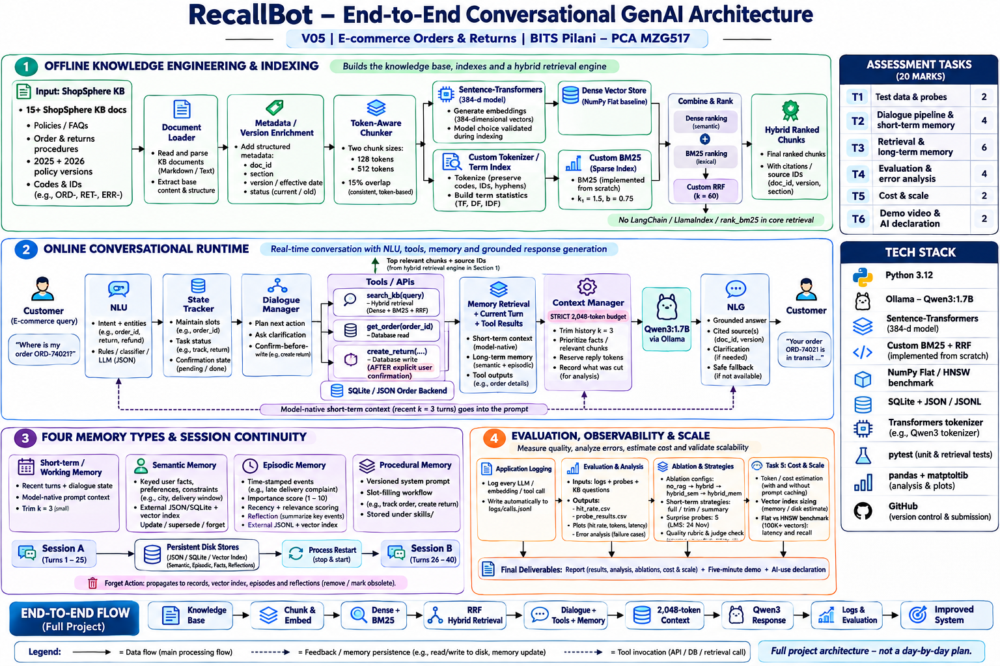

# RecallBot — V05 Mini Project 1

**Domain:** E-commerce orders and returns  
**Variant:** V05  
**Twist:** E — Small context window  
**Context window:** 2,048 tokens  
**Trim window:** k = 3 turns  
**Local chat model configured:** `qwen3:1.7b` via Ollama


## About the Project and Target Scope

**RecallBot** is an individual mini project for the BITS Pilani PCA MZG517 – Conversational Generative AI course.

- **Variant:** V05 – E-commerce Orders & Returns.
- **Objective:** Build a task-oriented conversational assistant that answers e-commerce queries, handles order and return workflows, and remembers returning users across sessions.
- **Hybrid RAG:** Combines dense semantic retrieval with custom BM25 and Reciprocal Rank Fusion (RRF).
- **Conversational Pipeline:** Implements NLU, entity extraction, state tracking, dialogue management, tool execution and response generation.
- **Memory Management:** Incorporates short-term, semantic, episodic and procedural memory with persistent storage across sessions.
- **Context Engineering:** Operates within a strict 2,048-token context window, prioritising relevant history, memories and retrieved knowledge.
- **Evaluation & Observability:** Measures retrieval performance, dialogue quality, token consumption, latency, cost and scalability.
- **Local LLM:** Uses Qwen3:1.7B through Ollama for local conversational inference.

**Key Focus:** Implementing and evaluating an end-to-end Conversational GenAI system while applying concepts covered in CS1–CS5.


## Target End-to-End Architecture

The following architecture diagram illustrates the complete **RecallBot – Conversational GenAI** system for BITS Pilani PCA MZG517 Mini Project 1 (Variant V05 – E-commerce Orders & Returns).

It covers the end-to-end flow, including:

- **Offline Knowledge Engineering:** Document ingestion, metadata enrichment, chunking, embeddings and hybrid retrieval indexing.
- **Online Conversational Runtime:** NLU, state tracking, dialogue management, tool execution and grounded response generation.
- **Hybrid Retrieval:** Dense vector search, custom BM25 implementation and Reciprocal Rank Fusion (RRF).
- **Memory Management:** Short-term, semantic, episodic and procedural memory with persistence across sessions.
- **Context Engineering:** Strict 2,048-token context budget with history trimming and information prioritisation.
- **Evaluation & Observability:** Application logging, retrieval evaluation, ablation studies, error analysis and cost estimation.
- **Assessment & Technology Stack:** All six project tasks and the technologies used for implementation.



*Figure: RecallBot – Complete end-to-end system architecture (V05).*

## Day 1 project assets

- `data/kb/`: 16 synthetic ShopSphere knowledge documents, including archived/current 2025–2026 return and shipping policy pairs.
- `data/kb_questions.json`: 32 retrieval questions with gold answer spans and document IDs.
- `data/test_conversation.json`: 40 user turns, Session A (1–25) and Session B (26–40), planted facts, updates, forget request and expected episodes.
- `data/probes.json`: 16 probes covering the seven required categories and two small-context twist probes.
- `data/surprise_probes.json`: placeholder to populate with the five LMS probes released on 24 November 2026.
- `db/seed_orders.json` and `db/seed_pickup_slots.json`: deterministic synthetic fixtures for read and pickup-slot development.
- `skills/`: versioned system prompt and return-pickup workflow (procedural memory).

All ShopSphere policies, orders, user details, codes and references in this project are synthetic test data. Tool outcomes, RMA references, complaint case IDs and measured logs must be generated by actual program runs; do not copy expected examples into logs as if they happened.

## Environment setup (Windows PowerShell)

```powershell
cd RecallBot_V05_MP1
py -3.12 -m venv .venv
.\.venv\Scripts\Activate.ps1

## If venv commands gives error, execute below command:
Set-ExecutionPolicy -Scope Process -ExecutionPolicy Bypass

python -m pip install --upgrade pip
pip install -r requirements.txt
```

If you use a different supported Python 3.10+ interpreter, replace `py -3.12` accordingly.

## Verify local Ollama model

```powershell
ollama list
ollama run qwen3:1.7b
```

In another terminal, activate the same virtual environment and run:

```powershell
python -m src.main --check
python -m src.main --test-ollama
```

The first command validates the data assets without using the LLM. The second makes one real local chat request and appends the measured call to `logs/calls.jsonl`. A failed attempted call is also logged with zero returned token usage and its failure type.

## Logging rule

Every real LLM, embedding and tool call must be timed and appended through `src.logger.log_call`. Never hand-edit or delete `logs/calls.jsonl`. Start a new run ID for a new experiment (for example by setting `RECALLBOT_RUN_ID` before launching a run). The project logger validates the professor's allowed `config` and `call_type` values.


## Current Implementation Status

| Task | Area | Status |
|---|---|---|
| Task 1 | Test data, knowledge base and probes | Completed and validated |
| Task 2 | Dialogue pipeline and short-term memory | Completed — Task 2(a), 2(b) and 2(c) implemented, evaluated and documented |
| Task 3(a) | Chunking, embeddings and indexing | Implemented and tested |
| Task 3(b) | Dense, BM25 and hybrid retrieval | Implemented, evaluated and documented |
| Task 3(c–f) | Semantic, episodic, context engineering and twist | Completed — official run `t3_hm_01`, probes manually judged 13/16 — see `docs/task-evidence/Task-3-Retrieval-and-Long-Term-Memory.md` |
| Task 4 | Evaluation, ablation and error analysis | Pending implementation |
| Task 5 | Cost and scalability | Pending implementation |
| Task 6 | Demo video and AI-use declaration | Pending |

### Completed Milestones

- Day 1: Project foundation, synthetic e-commerce knowledge base, retrieval questions, scripted conversation and probes.
- Day 2: Token-aware chunking, BGE embeddings, dense retrieval, custom BM25, custom RRF, answer-span hit-rate evaluation and ranked-list analysis.
- Day 3: Task 2(a) dialogue pipeline, Task 2(b) short-term memory comparison, and Task 2(c) context-handling analysis completed.
- Day 4: Task 3(c–f) long-term memory (semantic facts, episodic stream, reflection, forget cascade), 2,048-token context assembler and Session A → B as separate processes; pilot, calibration and official `hybrid_mem` run completed.

All reported results are generated from actual local executions and retained in `logs/` and `results/`.


# RecallBot V05 — Day 2: Retrieval Engine

This is an incremental addition to the Day 1 project. It does not replace Day 1
assets, `src/main.py`, `src/config.py`, the Day 1 logger, or the Git history.

## Retrieval design decisions

- **Chunk sizes:** 128 and 512 tokens, counted using the Qwen3 tokenizer.
- **Overlap:** 15% (19 tokens for 128; 77 tokens for 512 after integer rounding).
- **Chunk tokenizer:** `Qwen/Qwen3-1.7B`, matching the selected `qwen3:1.7b` chat model's tokenizer as closely as the Hugging Face tokenizer allows.
- **Embedding model:** `BAAI/bge-small-en-v1.5`.
- **Embedding dimension:** 384.
- **Embedding maximum sequence length:** 512 model tokens, according to the model card.
- **Pooling:** BGE's model-defined CLS pooling. If one Qwen-tokenized chunk is longer under BGE's tokenizer than the BGE input limit, it is split into safe BGE-token segments; their vectors are combined using a token-count-weighted mean and L2-normalised. This prevents silent truncation while preserving one vector per KB chunk.
- **Query instruction:** BGE's recommended short-query-to-passage instruction is prepended to queries only; it is not prepended to KB passages.
- **Dense retrieval:** exact flat NumPy search over L2-normalised vectors; dot product equals cosine similarity.
- **Sparse retrieval:** custom BM25 in `src/retrieval/bm25.py`; it preserves hyphenated IDs such as `RET-E14` as single tokens.
- **Hybrid retrieval:** custom Reciprocal Rank Fusion (RRF), using `k=60` as in the CS4 example.
- **Index selection:** An exact Flat NumPy index was selected because the current KB is small (84 and 24 chunks for the two configurations). It provides exact similarity results without ANN approximation or graph-index overhead. Flat versus HNSW performance will be benchmarked separately as part of Task 5.


The chat-token counts in `logs/calls.jsonl` use the Qwen tokenizer. BGE-specific
segment counts and token counts are stored in the log's `extra` metadata.

## Hit-rate definition

The official `results/hit_rate.csv` keeps the professor-required columns:

`method,chunk_size,k,question_id,hit`

A hit now means the retrieved top-k chunk intervals cover the complete gold answer
span in its source document. A chunk from the correct document but an unrelated
section is not counted as a success. Multiple retrieved adjacent/overlapping chunks
may jointly cover an answer span that crosses a chunk boundary.

A supplementary `results/hit_rate_diagnostics.csv` reports both answer-span hits
and document-level hits so that the difference can be analysed. Use answer-span
hit rate for the main Task 3(b) results.

New chunks record their source `start_char` and `end_char` offsets. Rebuild both
indexes after applying the Day 2 corrective patch; old indexes do not contain the
new offset metadata.

## Install/check dependencies

The Day 1 `requirements.txt` already lists `numpy`, `sentence-transformers`,
`transformers`, `pandas` and `pytest`; no dependency edit is required.

```powershell
pip install -r requirements.txt
```

## Run order

First run all offline tests. These tests do not download or call a model:

```powershell
python -m pytest tests/ -q
python -m pytest -v
```

Then build the dense indexes for both chunk sizes:

```powershell
python -m src.retrieval.build_index
```

The first run downloads the Qwen tokenizer and BGE embedding model from Hugging
Face if they are not already cached. It does not download Qwen chat-model weights;
those remain managed by Ollama.

Finally, evaluate dense, BM25 and hybrid retrieval:

```powershell
python -m src.retrieval.evaluate
```

This evaluates all KB questions at @1, @3 and @5 for each chunk size. It writes:

- `results/hit_rate.csv` — required raw results.
- `results/hit_rate_summary.csv` — overall, exact-code/ID and paraphrase aggregates.
- `results/hit_rate_diagnostics.csv` — document-level versus answer-span hit comparison.
- `results/retrieval_rankings.csv` — top-five ranked chunks, retrieval scores and cumulative answer-span coverage for Dense, BM25 and Hybrid retrieval.

Embedding calls are recorded in `logs/calls.jsonl`. No chat LLM is called during
indexing or retrieval evaluation. Keep real logs; never edit them by hand. If a run
fails, retain its log lines and use a new run ID for the next experiment.

## CS4 worked-example tests

BM25 uses the CS4 example inputs. The full-precision result is approximately
`4.1595405`, which rounds to `4.160`; the slide's displayed `4.159` comes from
rounding intermediate values before the final addition.

RRF with `k=60` reproduces the ranking A, B, C, D, followed by E and F tied.

## Retrieval Evaluation – Performance Comparison

Evaluated three retrieval strategies across two chunk sizes using 32 knowledge-base questions.

### Evaluation Configuration

- KB documents: 16
- Evaluation questions: 32
- Chunk sizes: 128 and 512 tokens
- Chunk overlap: 15%
- Retrieval methods: Dense, BM25 and Hybrid (RRF)
- Evaluation metrics: Answer-span Hit Rate @1, @3 and @5
- Total measurements: 576

### Overall Hit-Rate Comparison


[View / Open Retrieval Performance Chart](images/retrieval-hit-rate-comparison.png)


### Hit-Rate Breakdown by Question Category

To further analyse retrieval performance, the 32 evaluation questions were divided into two categories: exact code/ID questions and paraphrased questions with no answer keywords.

#### A. Exact Code or ID Questions (10 Questions)

| Chunk Size | Method | Hit Rate @1 | Hit Rate @3 | Hit Rate @5 |
|---|---|---:|---:|---:|
| 128 tokens | Dense | 50% | 80% | 80% |
| 128 tokens | BM25 | 30% | 90% | 100% |
| 128 tokens | Hybrid (RRF) | 60% | 90% | 100% |
| 512 tokens | Dense | 70% | 80% | 80% |
| 512 tokens | BM25 | 60% | 100% | 100% |
| 512 tokens | Hybrid (RRF) | 70% | 80% | 100% |

#### B. Paraphrased Questions with No Answer Keywords (5 Questions)

| Chunk Size | Method | Hit Rate @1 | Hit Rate @3 | Hit Rate @5 |
|---|---|---:|---:|---:|
| 128 tokens | Dense | 0% | 60% | 100% |
| 128 tokens | BM25 | 0% | 0% | 20% |
| 128 tokens | Hybrid (RRF) | 20% | 40% | 60% |
| 512 tokens | Dense | 40% | 100% | 100% |
| 512 tokens | BM25 | 60% | 80% | 100% |
| 512 tokens | Hybrid (RRF) | 60% | 100% | 100% |

*Note: Hit rates are calculated using strict answer-span coverage. The exact-code/ID category contains 10 questions, while the paraphrased category contains 5 questions. Percentages are based on the actual evaluation results.*


### Key Observations

1. **512-token chunks performed better overall:** Hybrid retrieval achieved 96.9% Hit Rate @5, compared with 84.4% using 128-token chunks.

2. **Hybrid improved first-result relevance:** With 512-token chunks, Hybrid achieved 75% at @1, outperforming Dense (71.9%) and BM25 (62.5%).

3. **BM25 performed particularly well:** With 512-token chunks, BM25 achieved 100% Hit Rate @5 across the evaluation questions.

4. **Hybrid does not always outperform individual methods:** BM25 achieved 100% at @5, compared with Hybrid's 96.9%. This demonstrates that rank fusion does not guarantee an improvement in every case.

5. **Chunk size influenced retrieval quality:** Larger chunks preserved more surrounding context and achieved higher answer-span coverage in this experiment.

### Conclusion

The initial experiments indicate that 512-token chunks provide stronger retrieval performance for this knowledge base. Hybrid retrieval provides a good balance between semantic and lexical retrieval, particularly at the first-result position.

*Note: Results are specific to the current 32-question evaluation dataset and should not be interpreted as universal retrieval benchmarks.*

## Task 3(b) – Hybrid Retrieval: Ranked-List Case Studies

To understand the behaviour of hybrid retrieval, two questions from the 32-question evaluation dataset were examined using the actual Dense, BM25 and RRF ranked lists.

The objective was to demonstrate one instance where hybrid retrieval corrected a retrieval failure and another where rank fusion did not preserve a relevant result.

### Case Study A – Hybrid Retrieval Fixes a Top-1 Failure

**Question ID:** Q014

**Question:** What must the bot show before it creates a pickup booking?

**Expected answer:** Before creating a pickup, show the order ID, item description, return reason, pickup date, time window and address summary.

**Source document:** KB-013 – Reverse Pickup and Packaging Guide.

**Configuration:** 128-token chunks, 15% overlap, RRF k=60, evaluated at @1.

| Method | Rank 1 chunk | Score | Answer-span hit |
|---|---|---:|---:|
| Dense | KB-013-C128-0004 (Packaging) | 0.656333 | No |
| BM25 | KB-002-C128-0005 (Excluded products) | 9.573864 | No |
| Hybrid | KB-013-C128-0002 (Pickup eligibility) | 0.032258 | Yes |

The answer-bearing chunk, `KB-013-C128-0002`, was ranked second by both Dense and BM25.

| Method | Original rank of relevant chunk |
|---|---:|
| Dense | 2 |
| BM25 | 2 |
| Hybrid | **1** |

Using Reciprocal Rank Fusion with k=60:

`RRF = 1/(60+2) + 1/(60+2) = 0.032258`

The same chunk received contributions from both retrieval systems and achieved the highest RRF score.

**Observation:** Neither individual retrieval method returned the correct answer-bearing chunk at rank 1. Hybrid fusion promoted their common relevant result to rank 1, successfully fixing the top-1 retrieval failure.

### Case Study B – Hybrid Retrieval Does Not Preserve a Relevant BM25 Result

**Question ID:** Q023

**Question:** Which team should handle a refund settlement mismatch?

**Expected answer:** The PAYMENTS team handles refund or settlement mismatches.

**Source document:** KB-014 – Customer Support Service Levels and Escalation.

**Configuration:** 512-token chunks, 15% overlap, RRF k=60, evaluated at @5.

BM25 successfully retrieved the answer-bearing chunk `KB-014-C512-0001` at rank 2, with a BM25 score of 6.720382.

Dense retrieval did not retrieve this chunk within its top five results.

The top-five hybrid ranking was:

| Rank | Chunk ID | RRF score | Answer-span hit |
|---:|---|---:|---|
| 1 | KB-001-C512-0002 | 0.031754 | No |
| 2 | KB-010-C512-0001 | 0.031498 | No |
| 3 | KB-004-C512-0001 | 0.031258 | No |
| 4 | KB-003-C512-0001 | 0.016393 | No |
| 5 | KB-008-C512-0001 | 0.016393 | No |

The relevant chunk appeared only in BM25's ranked list, at position 2. It received a single RRF contribution:

`RRF = 1/(60+2) = 0.016129`

Other chunks received contributions from both Dense and BM25, resulting in higher fusion scores.

Reconstructing the complete fused candidate ordering from the two baseline top-five lists places the relevant chunk at rank 6, just outside the evaluated top-five cutoff.

| Method | Hit @5 |
|---|---:|
| Dense | 0 |
| BM25 | 1 |
| Hybrid | 0 |

**Observation:** Hybrid fusion did not preserve a relevant result that BM25 had successfully retrieved. RRF favoured documents appearing in both ranking lists, pushing the BM25-only answer-bearing chunk below the top-five cutoff.

### Overall Learning

These two examples demonstrate both the benefit and limitation of Reciprocal Rank Fusion:

- RRF can improve first-result relevance by rewarding agreement between dense semantic retrieval and sparse lexical retrieval.
- RRF does not guarantee that every relevant result from an individual retriever will survive the final ranking cutoff.
- The effectiveness of hybrid retrieval depends on the candidate rankings, RRF constant and retrieval cutoff.

The experiment demonstrates that hybrid retrieval provides a useful balance of semantic and lexical matching, but its results should always be evaluated against the individual retrieval baselines.

*Evidence: `results/retrieval_rankings.csv`, question IDs Q014 and Q023, and the corresponding answer-span hit records in `results/hit_rate.csv`.*

# Day 3 — Task 2(a): Conversational Agent Implementation

> **Project:** RecallBot V05  
> **Milestone:** Day 3 / Task 2(a)  
> **Status:** Core implementation operational; end-to-end return workflow demonstrated  
> **Latest automated validation:** 106 tests passed

This section consolidates the Task 2(a) implementation notes into one chronological, append-ready project record. It describes the final integrated implementation rather than the individual intermediate ZIP-patch instructions.

---

## 1. Objective and scope

Task 2(a) implements the conversational agent pipeline for RecallBot V05. The agent combines the existing Day 1 test data and Day 2 retrieval components with a dialogue manager, state tracking, local tools, procedural memory and Qwen-based natural-language generation (NLG).

The implementation is incremental: it reuses the existing NLU, state tracker, hybrid retrieval engine, logger, seed fixtures and project configuration rather than replacing the earlier work.

The main responsibilities are:

- Understand the user's message and extract intent/entities.
- Maintain the current dialogue and return-task state.
- Route each turn to the appropriate retrieval or operational tool.
- Generate a grounded customer-facing response with local Qwen through Ollama.
- Keep critical actions deterministic and require explicit user confirmation before booking.
- Record tool, embedding, NLU and model-call activity for evaluation and debugging.

## 2. End-to-end architecture

```text
User message
    |
    v
NLU — intent and entity extraction
    |
    v
Dialogue Manager <------> Dialogue State Tracker
    |
    +---- Knowledge question ----> Tool Gateway ----> Hybrid KB retrieval
    |                                                   Dense + BM25 + RRF
    |
    +---- Order question --------> Order JSON lookup
    |
    +---- Return workflow -------> Pickup-slot lookup / booking validation
    |
    v
Response draft + state + retrieved evidence
    |
    v
Qwen NLG (local Ollama model)
    |
    v
Grounded customer-facing response
    |
    v
Call and tool logging
```

The Dialogue Manager owns orchestration and action routing. The state tracker owns dialogue/task state and the confirmation gate. The tool gateway performs the actual local reads and writes. Qwen improves response wording; it does not independently authorize operational actions.

## 3. Implementation sequence

### 3.1 Dialogue Manager and orchestration boundary

The first Task 2(a) implementation introduced `DialogueManager` as the orchestration layer over the existing NLU, State Tracker, logger and an injected tool gateway.

The manager:

- Routes recognized intents to the appropriate workflow.
- Coordinates the state tracker and tool gateway.
- Handles knowledge-base and order queries.
- Advances the return/pickup workflow as required slots are collected.
- Returns a structured turn result.
- Uses deterministic response templates and an extractive knowledge-base fallback when NLG is unavailable or fails.

The tool gateway contract includes:

- `get_order(order_id, customer_id)`
- `search_kb(query, top_k)`
- `check_pickup_slots(pickup_date, requested_window, address_summary)`
- `book_slot(arguments)`

The manager itself does not directly mutate the order or pickup seed databases.

### 3.2 Real tool execution and JSON database integration

The next step connected the manager to concrete local tools in `src/dialogue/tools.py`.

#### Knowledge-base search

`search_kb(query)` uses the existing Day 2 retrieval components:

1. Embed the query using the configured BGE embedding model.
2. Retrieve dense-search candidates.
3. Retrieve BM25 candidates.
4. Fuse rankings using the existing Reciprocal Rank Fusion implementation (`k=60`).
5. Return chunk text, source IDs, section metadata and version metadata.

The Day 2 retrieval architecture and ranking logic are reused; Task 2(a) does not replace them.

#### Order lookup

`get_order(order_id, customer_id)` reads `db/seed_orders.json` and verifies that the order belongs to the active customer before returning order details.

#### Pickup-slot lookup

`check_pickup_slots(...)` checks the runtime pickup database and filters slots against the requested date, time window and service area. When multiple slots match, RecallBot asks the user to choose rather than selecting one arbitrarily.

#### Booking

`book_slot(arguments)` performs the operational write only after explicit confirmation. Before writing, it rechecks:

- `explicit_confirmation=True`;
- customer ownership;
- SKU membership in the order;
- current slot availability.

A successful booking marks the chosen slot as booked and appends a booking/RMA record. The write uses an OS-level lock and atomic file replacement to reduce the risk of concurrent or duplicate booking writes.

#### Seed and runtime database separation

- `db/seed_orders.json` is the immutable order fixture.
- `db/seed_pickup_slots.json` is the immutable pickup-slot seed fixture.
- `db/runtime_pickup_slots.json` is the runtime database used for booking updates.

The runtime pickup database is initialized from the seed fixture. Booking writes affect the runtime file only; the original seed fixtures remain unchanged.

To start a fresh booking demonstration:

```powershell
.\.venv\Scripts\python.exe -m src.dialogue.run_demo --reset-db
```

`--reset-db` intentionally resets runtime pickup bookings from the seed fixture. Use it only when a fresh demonstration is required. It does not reset the immutable seed files or historical `logs/calls.jsonl` entries.

### 3.3 Qwen NLG integration

`src/dialogue/qwen_nlg.py` connects the application to the local Ollama model. The interactive demo enables Qwen NLG by default, while `--disable-nlg` allows the deterministic fallback path to be tested separately.

#### Model and decoding configuration

- Model: configured through `RECALLBOT_CHAT_MODEL`; default `qwen3:1.7b`.
- Runtime: local Ollama service.
- Task turns: temperature `0.0`, top-p `0.9`.
- Open turns: temperature `0.3`, top-p `0.9`.
- Context window: V05 limit of 2,048 tokens.
- Task output reserve: 160 tokens.
- Prompt safety margin: 32 tokens.
- Request: `think=False`, `stream=False`.
- HTTP client timeout: 90 seconds.

The prompt is assembled from the versioned system prompt, workflow guidance, current turn, compact dialogue state, deterministic response draft and (for knowledge-base questions) retrieved evidence and source metadata.

#### Procedural memory

The NLG component loads these files at runtime:

- `skills/system_prompt_v1.txt`
- `skills/return_pickup_workflow_v1.json`

They define the assistant's role, scope, grounding and dialogue rules, together with the procedural steps and required slots for the return-pickup workflow.

#### Grounding and safe fallback

The deterministic response draft is the authoritative outline for actions and critical facts. Qwen generates customer-facing wording using the supplied task state and retrieved evidence. Critical values such as order IDs, SKU values, dates, times and booking references are protected; if generation drops required values, the deterministic response is used.

If Ollama is unavailable, times out or generation fails, the application retains the deterministic response path. Failed model calls are recorded in the call log.

### 3.4 Pickup-slot selection and confirmation safeguards

The demo displays pickup windows in 24-hour format. NLU was extended to recognize exact displayed values such as:

- `18:00–20:00`
- `18:00-20:00`
- `18:00 to 20:00`

These values are normalized to a start/end time pair, for example:

```json
{"start": "18:00", "end": "20:00"}
```

The manager rechecks slot availability for the selected range and prepares a booking summary. It does not call `book_slot` until the user explicitly confirms.

Additional regression fixes include:

- Stripping balanced outer quotation marks before matching anchored intents, so copied text such as `"Yes, I confirm the pickup booking."` is recognized.
- Avoiding a second pending confirmation while a confirmation is already awaiting the user.
- Filtering a broader slot result to the exact start/end pair selected by the user.
- Calling Ollama with `think=False` so customer-facing content is taken from the response message rather than a separate reasoning field.

## 4. Reliability and prompt-budget hardening

During the first live policy-query test, the application completed NLU, retrieval and policy-version resolution but did not reach the Ollama request. Instrumentation localized the delay to prompt preparation for evidence-bearing turns.

Two incremental improvements were implemented and regression-tested.

### 4.1 Local-only tokenizer loading and token accounting

- NLU logging uses a local-only tokenizer load and a safe fallback estimate when tokenizer assets are unavailable.
- Retrieval model initialization is configured to use locally available model assets rather than unexpectedly downloading during an interactive turn.
- The NLG prompt-budget tokenizer uses local cache only (`local_files_only=True`).
- If it is unavailable, the existing conservative character-based estimate is used for prompt preparation.
- Token counts are cached within the NLG instance.
- Prompt construction is inside the NLG error/logging boundary, so a prompt-preparation failure is recorded and handled through deterministic fallback.
- Ollama calls use a finite HTTP timeout of 90 seconds, with timeout failures recorded distinctly.

The BGE model is expected to be available in the project's local environment. The local-only setting deliberately avoids unexpected model downloads during user interaction.

### 4.2 Token-ID-based evidence truncation

The original evidence truncation used repeated character-prefix searches and token counting. It was replaced with token-ID-based truncation when the local tokenizer is available:

1. Encode the evidence passage without adding special tokens.
2. Return the original text if it is already within the configured limit.
3. Otherwise, retain the first `max_tokens` token IDs and decode them.
4. Verify the decoded text against the same token-counting convention used by prompt budgeting.
5. Handle boundary discrepancies by reducing the retained token prefix until it satisfies the limit.

If the local tokenizer is unavailable, the fallback path is retained. Injected/custom token counters are verified against their own counting convention rather than assuming one token per three characters.

### 4.3 Bounded prompt evidence trimming

The initial formatted evidence is limited to at most three chunks, with a maximum of 180 tokens per chunk. If the combined prompt exceeds its safe input budget, the prompt builder repeatedly shortens the largest evidence chunk and removes a chunk once it reaches 32 tokens or fewer.

The loop now has explicit progress and termination safeguards:

- Each shortening operation must make the evidence text strictly shorter.
- A no-progress operation raises a descriptive exception.
- The derived iteration limit is 12 operations for the current configuration.
- The final combined prompt is checked against the safe input budget before it is sent to Ollama.
- If the prompt still cannot fit, the existing NLG failure and deterministic fallback path is used.

The iteration bound follows the current reduction strategy: a chunk of at most 180 tokens is approximately halved until it reaches 32 tokens or fewer, then removed. This requires at most four operations per chunk; with three chunks, the maximum is twelve operations.

### 4.4 Prompt budget

With a 2,048-token context, a 160-token task output reserve and a 32-token safety margin, the safe input budget is:

```text
2048 - 160 - 32 = 1856 tokens
```

The runtime evidence-bearing policy prompt initially measured 2,150 tokens. After seven evidence-trimming operations, it measured 1,739 tokens and was within the 1,856-token input budget. Prompt construction completed in approximately 93 ms in that run.

## 5. Logging and observability

The application uses the existing `src.logger.log_call` interface and `logs/calls.jsonl`.

Relevant call types include:

- `nlu` — intent/entity analysis and token accounting.
- `chat` — Qwen/Ollama response generation, including token usage and latency when returned by the API.
- `tool` — order, knowledge-base, pickup-slot and booking operations.
- `embed` — query embedding activity.

The runtime also prints stage timings around NLU, state updates, retrieval initialization, query embedding, dense retrieval, BM25/RRF, policy-version resolution, prompt construction, Ollama client creation, model inference and chat-call logging.

To inspect Qwen calls in PowerShell:

```powershell
Get-Content .\logs\calls.jsonl |
    ForEach-Object { $_ | ConvertFrom-Json } |
    Where-Object {
        $_.call_type -eq "chat" -and
        $_.extra.purpose -eq "qwen_nlg_response"
    } |
    Select-Object run_id, user, session, turn, model,
        input_tokens, output_tokens, latency_ms,
        @{Name="TurnType"; Expression={$_.extra.turn_type}},
        @{Name="Status"; Expression={$_.extra.status}} |
    Format-Table -AutoSize
```

## 6. End-to-end demonstration

The final local demonstration exercised the following sequence:

1. `Check the status of order ORD-74021.` — reads the order and verifies customer ownership.
2. `What is the return policy?` — executes hybrid retrieval, filters current-policy evidence, prepares the prompt and generates a Qwen response.
3. `I need to return the wireless earbuds from order ORD-74021.` — starts the return flow and verifies the order item.
4. `The left earbud does not charge.` — captures the return reason.
5. `Saturday, 28 November 2026 would work.` — captures the pickup date.
6. `After 6 pm.` — checks available slots and asks the user to choose when multiple windows match.
7. `18:00–20:00` — selects the exact displayed pickup window and rechecks availability.
8. `Yes, I confirm the pickup booking.` — passes the explicit confirmation gate and invokes the booking tool.

The live run completed successfully. The booking tool returned success and produced a confirmed RMA/booking reference. The runtime pickup database was updated; the immutable seed fixtures were not modified.

## 7. Automated validation

The latest complete regression run after the prompt-truncation and bounded-trimming changes reported:

```text
106 passed
```

The Task 2(a) test coverage includes NLU, state tracking, dialogue management, real tool integration, booking safeguards, Qwen NLG, timeout/fallback handling, tokenizer behaviour and prompt-budget reliability.

The test suite uses mocks/fakes for model and tool behaviour where appropriate. The interactive Ollama conversation and confirmed booking were also demonstrated separately on the local environment; those runtime checks are not inferred solely from unit-test success.

Recommended full-suite command from the project root:

```powershell
$parent = Join-Path $env:LOCALAPPDATA "Temp\RecallBotPytest"
New-Item -ItemType Directory -Path $parent -Force | Out-Null
$testTemp = Join-Path $parent ("full-" + [guid]::NewGuid().ToString("N"))

.\.venv\Scripts\python.exe -m pytest -q -p no:cacheprovider --basetemp="$testTemp"
```

## 8. Key files and components

| Path | Responsibility |
|---|---|
| `src/dialogue/nlu.py` | Intent recognition and entity extraction |
| `src/dialogue/state_tracker.py` | Dialogue/task state and confirmation handling |
| `src/dialogue/dialogue_manager.py` | Turn orchestration and intent routing |
| `src/dialogue/tools.py` | JSON-backed tools and retrieval gateway |
| `src/dialogue/qwen_nlg.py` | Prompt preparation and Ollama/Qwen response generation |
| `src/dialogue/run_demo.py` | Interactive local demo |
| `src/retrieval/` | Existing Day 2 tokenization, embedding and hybrid retrieval components |
| `skills/system_prompt_v1.txt` | Versioned system/procedural instructions |
| `skills/return_pickup_workflow_v1.json` | Versioned return-pickup workflow definition |
| `db/seed_orders.json` | Immutable order fixture |
| `db/seed_pickup_slots.json` | Immutable pickup-slot fixture |
| `db/runtime_pickup_slots.json` | Runtime pickup/booking data |
| `logs/calls.jsonl` | Append-only application call log |
| `tests/` | Unit, integration and regression coverage |

## 9. Known follow-up before final submission

The successful policy-query output showed the `Sources:` footer twice in one runtime response. Code inspection indicates that `QwenNLG.generate_reply()` is the canonical owner that appends source citations, but the model can also echo source labels supplied in its prompt. A narrow correction to prevent model-echoed citation footers and a regression asserting exactly one canonical footer were identified but had not yet been implemented in the latest reviewed state.

The current-policy retrieval path filters to active/current evidence before generation. The final policy answer should still be reviewed against the actual retrieved active passages to verify that relevant policy details are not omitted. This is a response-quality check, not a change to the retrieval or policy-version-selection architecture.

## 10. Task 2(a) outcome

The core Task 2(a) conversational-agent pipeline is implemented and has been exercised end to end. The system can answer an order query, retrieve active knowledge-base evidence, guide a customer through a return/pickup workflow, check available slots, request explicit confirmation and execute a guarded booking write. The latest full regression suite reports 106 passing tests.

The next assignment milestone is **Task 2(b): comparison of full conversation history, trim-last-k=3 and summary-plus-last-2-turns short-term memory strategies**, including fair token accounting and summary-generation overhead.

## Task 2(b) — Short-Term Memory Strategies

**Status: Implemented, replayed and token analysis completed.**

RecallBot V05 implements and compares three short-term conversation-history strategies while keeping the same rule-based NLU, Dialogue State Tracker, tools, Qwen model, system prompt and decoding configuration enabled.

### Implemented strategies

| Strategy | Context supplied to customer-facing Qwen call |
|---|---|
| `full` | The complete history of completed user/assistant exchanges. |
| `trim` | The last **3 completed exchanges** (`k = 3`, Variant V05). |
| `summary` | A rolling summary generated through a separate Qwen LLM call, plus the last **2 completed exchanges**. |

For this implementation, a conversational turn is represented as one completed user/assistant exchange. The State Tracker remains active for every original user message in all three strategies; history selection does not replace or modify structured dialogue state.

### Session A evaluation

The exact 25 user messages from Session A (`data/test_conversation.json`, turns 1–25) were replayed independently for each strategy. Each run used a fresh Dialogue Manager, conversation history, State Tracker and summary memory (where applicable), and reset the runtime pickup database from the same immutable seed fixture.

| Strategy | Official run ID | Turns processed | Chat fallbacks | Successful chat calls | Summary calls |
|---|---|---:|---:|---:|---:|
| Full | `task2b_full_run3` | 25/25 | 12 | 13 | 0 |
| Trim | `task2b_trim_run2` | 25/25 | 3 | 22 | 0 |
| Summary | `task2b_summary_run2` | 25/25 | 9 | 16 | 22 |

The 24 fallback responses were caused by prompt-budget failures before Ollama inference (Full: 12; Trim: 3; Summary: 9). The replay continued safely and processed all 25 user messages in every run. All 22 summary-generation calls in the Summary run succeeded. No successful booking write occurred in these official replays; the confirmation did not match the active tracked order/item, so the booking safeguard correctly prevented the write. Booking-path evidence is followed up separately under Task 2(c).

### Token results

The official Stage 5 analysis used only the three run IDs listed above and read the append-only `logs/calls.jsonl` file.

| Strategy | Logged input tokens | Logged output tokens | Logged total tokens | Exact Ollama input + output tokens |
|---|---:|---:|---:|---:|
| Full | 53,116 | 313 | 53,429 | 22,091 |
| Trim | 42,220 | 773 | 42,993 | 36,778 |
| Summary | 52,815 | 3,127 | 55,942 | 37,016 |

The Summary strategy made 22 additional summary-generation calls, consuming **8,197 input tokens** and **2,706 output tokens** (**10,903 summary tokens** in total). This overhead is included once in the Summary totals.

Logged totals include the project’s logged NLU, embedding and model-call token fields. The exact Ollama totals count model usage reported by Ollama. Prompt-preparation failures are represented as attempted prompt input, not as tokens processed by the model. Tool calls follow the assignment convention and log zero input, output and retrieved tokens. `retrieved_tokens` is reported separately and is not added again to `input_tokens`.

Full’s lower exact Ollama total is partly explained by its 12 prompt-budget fallbacks: those prompts were not submitted to Ollama. Token totals alone therefore do not establish that Full is more efficient or that any strategy gives better answers. Trim had the lowest logged total and the fewest fallback turns in this Session A experiment; answer quality and probe accuracy are assessed separately.

### Evidence and reproducibility

- Per-turn input-token plot: `results/task2b_input_tokens_per_turn.png`
- Strategy token summary: `results/task2b_token_summary.csv`
- Per-turn token data: `results/task2b_token_per_turn.csv`
- Stage 5 analysis report: `results/task2b_stage5_report.md`
- Reproducible analysis script: `scripts/analyze_task2b_logs.py`
- Official Session A transcripts: `results/task2b_*_session_A_*.json`
- Run manifest: `results/task2b_session_A_run_manifest.json`

Re-run the analysis from the project root without rerunning Session A:

```powershell
.\.venv\Scripts\python.exe scripts\analyze_task2b_logs.py
```

The analysis script filters by the three official run IDs and regenerates the Stage 5 result files from `logs/calls.jsonl`.

**Scope note:** This section documents Task 2(b). Task 2(a) pipeline documentation and its labelled NLU accuracy result, and Task 2(c) context-handling/probe analysis, are tracked separately in `docs/task-evidence/Task-2-Dialogue-Pipeline-and-Short-Term-Memory.md` and the remaining Task 2(c) work. Do not interpret completion of Task 2(b) as completion of all of Task 2.

# Task 2(c) — Context-Handling Analysis

**Status: Completed and documented.**

Task 2(c) evaluates how Full, Trim and Summary handle conversation context, state follow-ups, clarification and confirmation-gated actions.

### Official Session A Probe Evaluation

The actual `data/probes.json` dataset contains two probes assigned to Session A:

- **P08 — Knowledge-base answer:** Explain the meaning of `ERR-RMA-04` using the relevant active KB-007 evidence.
- **P10 — State follow-up:** Resolve the Saturday pickup request and incorporate the user's after-6-pm constraint using the existing dialogue state.

The corrected Session A replays were independently executed for all three strategies, using 25 original user turns per run.

| Strategy | P08 | P10 | Official probe accuracy |
|---|---|---|---:|
| Full | Correct | Correct | 2/2 (100%) |
| Trim | Correct | Correct | 2/2 (100%) |
| Summary | Correct | Correct | 2/2 (100%) |

All six official probe results were reviewed against the expected behavior, actual responses and supporting evidence.

P08 correctly explains that the return reason is missing or invalid and cites KB-007. In some runs, prompt-budget overflow triggered the deterministic fallback, but the resulting answer remained grounded and correct.

P10 correctly preserves the pickup date (28 November 2026), incorporates the after-6-pm constraint, checks actual slot availability and offers the available windows for customer selection.

**Important limitation:** Neither official Session A probe failed. The two-probe set does not directly test older-fact recall, so the 100% result should not be generalized as overall memory or answer quality.

### Supplemental Memory-Retention Diagnostics

To investigate older-fact retention separately, P01 and P03 from the existing probe dataset were used as supplemental short-term-memory diagnostics against the captured post-Session-A snapshots.

These results are not included in official Session A probe accuracy and do not claim persistent-memory functionality.

| Strategy | P01 — Updated delivery window | P03 — Updated notification channel |
|---|---|---|
| Full | Prompt-budget failure before inference | Prompt-budget failure before inference |
| Trim | Returned pickup time instead of the saved delivery window | Returned pickup details instead of SMS |
| Summary | Omitted the updated delivery window from its stored summary | Omitted the updated SMS preference from its stored summary |

Key findings:

- **Full:** Both diagnostic prompts exceeded the safe input budget (3,035 and 3,031 tokens against 1,888). These are context-budget failures, not semantic-recall failures.
- **Trim:** The source facts from turns 19 and 20 were outside the selected last-three-exchange history when the diagnostics were executed.
- **Summary:** The final stored summary omitted the updated 19:00–21:00 delivery window and SMS preference. Intermediate summary versions were not captured, so the exact update at which each fact was lost could not be established.

### Trim History-Window Analysis

Variant V05 uses `k = 3` completed user/assistant exchanges. The incoming user message is supplied separately.

The earliest user-specific fact was the preferred-name request at turn 2. It first leaves the selected Trim history at incoming turn 6, when the available completed exchanges are turns 3–5.

Other examples:

- Turn 4 email preference leaves at incoming turn 8.
- Turn 7 original delivery-window preference leaves at incoming turn 11.
- The updated delivery-window fact from turn 19 leaves at incoming turn 23.
- The SMS preference from turn 20 leaves at incoming turn 24.

History eviction does not automatically mean an incorrect answer. The official P08 and P10 probes did not depend on these older facts and both passed for all three strategies.

### State Follow-Up and Clarification

**Session A — Turn 15**

The tracker retained:

- Order: `ORD-74021`
- Item: `SKU-AUR-220`
- Pickup date: `2026-11-28`

The user requested a pickup after 6 pm. NLU classified this as `state_followup`, and the tracker merged the time constraint with the previously collected date.

The scheduler returned two available options:

- `PICK-20261128-E1`: 18:00–20:00
- `PICK-20261128-E2`: 20:00–22:00

RecallBot presented both options and asked the customer to select one. It did not choose a slot automatically.

**Session B — Turn 37 clarification**

The user requested a pickup for "the other item" without identifying the order or item. An isolated regression test verifies that RecallBot asks:

`Which order and item do you mean? Please provide the order ID or select an item.`

No order lookup, booking tool call or database write occurs in this ambiguous case. This is automated test evidence, not a full Session B runtime replay.

**Session B — Turn 33 state follow-up**

A focused integration test replays the relevant turns 31–33 with fresh state and KB evidence. It verifies a conditional explanation of the return lifecycle using KB-003 and KB-014.

The response is test-generated rather than a live Qwen runtime result. A pickup-specific status would require persistent episodic memory, which is outside the current Task 2 scope.

### Confirmation-Gated Booking Verification

The official Session A replays did not create a booking. The customer had not selected one of the available pickup windows, so no specific pending booking action was authorized.

A separate real tool-gateway integration test using an isolated temporary JSON database verifies the complete booking path:

1. Multiple available slots require explicit customer selection.
2. The selected slot, order, item, reason, date and address are recorded in the pending action.
3. The exact pending booking summary is presented for confirmation.
4. No database write occurs before explicit confirmation.
5. A matching confirmation invokes `book_slot` and persists the booking.
6. Mismatched confirmation is rejected.
7. Duplicate booking is prevented.

The integration test confirms that the persisted booking contains `confirmation_received: true` and the selected slot ID.

This successful integration-test booking is separate from the historical Session A replay outcomes.

### Reproducibility and Evidence Artifacts

| Artifact | Location |
|---|---|
| Official Session A probe results | `results/task2c_probe_results.csv` |
| Supplemental P01/P03 diagnostics | `results/task2c_supplemental_memory_diagnostics.json` |
| State follow-up and clarification evidence | `results/task2c_state_followup_and_clarification.md` |
| Booking confirmation evidence | `results/task2c_booking_confirmation_evidence.md` |
| Context-handling report | `results/task2c_context_handling_report.md` |
| Session A run manifest | `results/task2c_session_A_run_manifest.json` |
| Strategy snapshots | `results/task2c_snapshots/` |
| Updated assignment evidence | `docs/task-evidence/Task-2-Dialogue-Pipeline-and-Short-Term-Memory.md` |

### Task 2(c) Conclusion

The evaluation demonstrates correct handling of the two official Session A probes across all three short-term memory strategies, identifies the first Trim history-window eviction, and exposes older-fact retention and context-budget limitations through separate supplemental diagnostics.

State follow-up, clarification and confirmation-gated booking behavior are supported by actual replay evidence and separate integration tests, with their respective execution boundaries documented.

The results are limited to the supplied scripted conversation and probe set; they are not generalized to unseen customer traffic.

**Task 2(c) is completed and documented.**
# Day 4 — Task 3(c–f): Long-Term Memory and Context Engineering

**Status:** implemented, tested (226 tests, no model calls) and run live. Official run: `t3_hm_01` (config `hybrid_mem`). Full evidence: [`docs/task-evidence/Task-3-Retrieval-and-Long-Term-Memory.md`](docs/task-evidence/Task-3-Retrieval-and-Long-Term-Memory.md); design: [`docs/design/Task-3-Long-Term-Memory-Design.md`](docs/design/Task-3-Long-Term-Memory-Design.md).

### What was added

| Component | Path | Role |
|---|---|---|
| Semantic memory | `src/memory/semantic_memory.py`, `fact_extractor.py` | Keyed user facts (rules first, Qwen JSON fallback); update supersedes; deletable vector index |
| Episodic memory | `src/memory/episodic_memory.py`, `reflection.py` | Time-stamped events with rule-based importance; recency + importance + relevance score; end-of-session reflection |
| Forget cascade | `src/memory/forgetting.py`, `memory_manager.py` | Deletes facts and vectors, deletes/redacts episodes and reflections, hash-only tombstone |
| Context assembler | `src/context/context_assembler.py`, `skills/system_prompt_v2.txt` | 1,856-token input budget (2,048 − 160 reply − 32 safety), whole-item cuts with a drop log |
| Session runner | `src/dialogue/run_session.py` | One session per process; Session B loads memory only from disk and verifies file hashes |

### Headline results (official `t3_hm_01`)

| Measure | Result | Source |
|---|---|---|
| Fact extraction, rules + Qwen fallback | precision 1.00, recall 1.00 (9/9; rules only 0.89) | `results/task3_semantic_memory_metrics.json` |
| Episodic weighting kept | A (0.2 / 0.3 / 0.5): hit@1 0.583, MRR 0.757 vs B 0.417 / 0.607, C 0.417 / 0.646 | `results/task3_episodic_weight_comparison.csv` |
| Session B separate process | PIDs 106348 → 99088; loaded memory hashes equal Session A's | `memory/runs/t3_hm_01/session_manifest.json` |
| Budget | 0 fallbacks in 51 chat calls; max prompt 1,465 / 1,856; assembler count = Ollama count on every call | `logs/calls.jsonl` |
| Forget after restart | "side door" absent from all memory files and the Session B transcript | `memory/runs/t3_hm_01/` |
| Probes (manually judged) | 13/16 — failures P11 (retrieval), P13 (episodic scoring), P15 (NLG) | `results/probe_results.csv` |

### Reproduce the official run

```powershell
python -m src.dialogue.run_session --session A --config hybrid_mem --experiment t3_hm_01
python scripts/compare_episodic_weightings.py --experiment t3_hm_01
python -m src.dialogue.run_session --session B --config hybrid_mem --experiment t3_hm_01 --weighting A
python scripts/evaluate_semantic_extraction.py --experiment t3_hm_01
python scripts/context_assembly_report.py --experiment t3_hm_01 --run-id t3_hm_01_budget_stress2
```

A rerun needs a new experiment name: memory directories, transcripts and run IDs are never overwritten. Runs `t3_hm_pilot_*` and `t3_calibration` are the pilot and threshold calibration; `t3_hm_01_budget_stress` was superseded by `t3_hm_01_budget_stress2`.

### Demo: Task 3 in one command

```powershell
# Live: Session A and Session B run as two separate processes (~5-6 min with qwen3:1.7b), then verified
python -m src.dialogue.demo_memory

# Instant: explain an existing run (no chat-model calls; section 6 makes one logged embedding call)
python -m src.dialogue.demo_memory --verify-only --experiment t3_hm_01
```

Sections: (1) Session A with the confirmed booking, (2) process restart with PIDs and memory-file hashes, (3) the semantic facts, episodes, reflection and forget tombstone on disk, (4) Session B answers (fact, update, episodes, forgotten fact, cited KB answer, fallback), (5) failure case P13, (6) episodic scoring walkthrough, (7) per-turn token budget. If the PowerShell console shows garbled dashes, run `chcp 65001` first.
