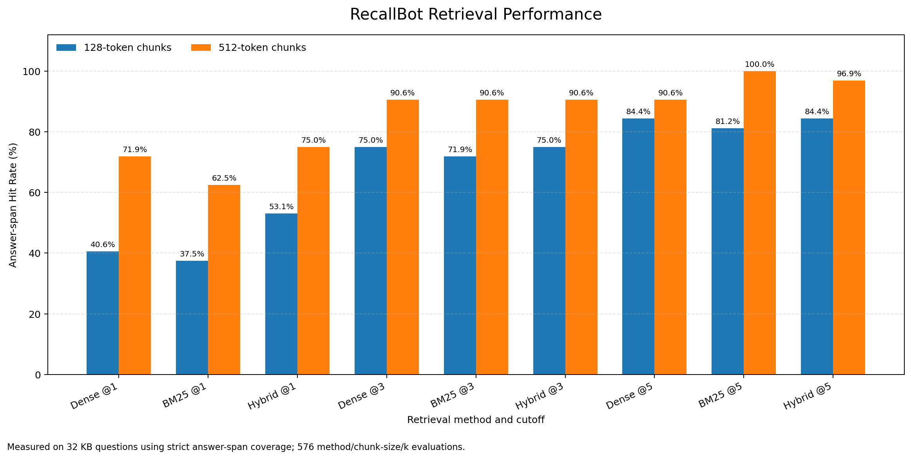

# RecallBot — V05 Mini Project 1

**Domain:** E-commerce orders and returns  
**Variant:** V05  
**Twist:** E — Small context window  
**Context window:** 2,048 tokens  
**Trim window:** k = 3 turns  
**Local chat model configured:** `qwen3:1.7b` via Ollama


## About the Project and Target Scope

**RecallBot** is an individual mini project for the BITS Pilani PCA MZG517 – Conversational Generative AI course.

- **Variant:** V05 – E-commerce Orders & Returns.
- **Objective:** Build a task-oriented conversational assistant that answers e-commerce queries, handles order and return workflows, and remembers returning users across sessions.
- **Hybrid RAG:** Combines dense semantic retrieval with custom BM25 and Reciprocal Rank Fusion (RRF).
- **Conversational Pipeline:** Implements NLU, entity extraction, state tracking, dialogue management, tool execution and response generation.
- **Memory Management:** Incorporates short-term, semantic, episodic and procedural memory with persistent storage across sessions.
- **Context Engineering:** Operates within a strict 2,048-token context window, prioritising relevant history, memories and retrieved knowledge.
- **Evaluation & Observability:** Measures retrieval performance, dialogue quality, token consumption, latency, cost and scalability.
- **Local LLM:** Uses Qwen3:1.7B through Ollama for local conversational inference.

**Key Focus:** Implementing and evaluating an end-to-end Conversational GenAI system while applying concepts covered in CS1–CS5.


## Target End-to-End Architecture

The following architecture diagram illustrates the complete **RecallBot – Conversational GenAI** system for BITS Pilani PCA MZG517 Mini Project 1 (Variant V05 – E-commerce Orders & Returns).

It covers the end-to-end flow, including:

- **Offline Knowledge Engineering:** Document ingestion, metadata enrichment, chunking, embeddings and hybrid retrieval indexing.
- **Online Conversational Runtime:** NLU, state tracking, dialogue management, tool execution and grounded response generation.
- **Hybrid Retrieval:** Dense vector search, custom BM25 implementation and Reciprocal Rank Fusion (RRF).
- **Memory Management:** Short-term, semantic, episodic and procedural memory with persistence across sessions.
- **Context Engineering:** Strict 2,048-token context budget with history trimming and information prioritisation.
- **Evaluation & Observability:** Application logging, retrieval evaluation, ablation studies, error analysis and cost estimation.
- **Assessment & Technology Stack:** All six project tasks and the technologies used for implementation.


*Figure: RecallBot – Complete end-to-end system architecture (V05).*

## Day 1 project assets

- `data/kb/`: 16 synthetic ShopSphere knowledge documents, including archived/current 2025–2026 return and shipping policy pairs.
- `data/kb_questions.json`: 32 retrieval questions with gold answer spans and document IDs.
- `data/test_conversation.json`: 40 user turns, Session A (1–25) and Session B (26–40), planted facts, updates, forget request and expected episodes.
- `data/probes.json`: 16 probes covering the seven required categories and two small-context twist probes.
- `data/surprise_probes.json`: placeholder to populate with the five LMS probes released on 24 November 2026.
- `db/seed_orders.json` and `db/seed_pickup_slots.json`: deterministic synthetic fixtures for read and pickup-slot development.
- `skills/`: versioned system prompt and return-pickup workflow (procedural memory).

All ShopSphere policies, orders, user details, codes and references in this project are synthetic test data. Tool outcomes, RMA references, complaint case IDs and measured logs must be generated by actual program runs; do not copy expected examples into logs as if they happened.

## Environment setup (Windows PowerShell)

```powershell
cd RecallBot_V05_MP1
py -3.12 -m venv .venv
.\.venv\Scripts\Activate.ps1

## If venv commands gives error, execute below command:
Set-ExecutionPolicy -Scope Process -ExecutionPolicy Bypass

python -m pip install --upgrade pip
pip install -r requirements.txt
```

If you use a different supported Python 3.10+ interpreter, replace `py -3.12` accordingly.

## Verify local Ollama model

```powershell
ollama list
ollama run qwen3:1.7b
```

In another terminal, activate the same virtual environment and run:

```powershell
python -m src.main --check
python -m src.main --test-ollama
```

The first command validates the data assets without using the LLM. The second makes one real local chat request and appends the measured call to `logs/calls.jsonl`. A failed attempted call is also logged with zero returned token usage and its failure type.

## Logging rule

Every real LLM, embedding and tool call must be timed and appended through `src.logger.log_call`. Never hand-edit or delete `logs/calls.jsonl`. Start a new run ID for a new experiment (for example by setting `RECALLBOT_RUN_ID` before launching a run). The project logger validates the professor's allowed `config` and `call_type` values.


## Current Implementation Status

| Task | Area | Status |
|---|---|---|
| Task 1 | Test data, knowledge base and probes | Completed and validated |
| Task 2 | Dialogue pipeline and short-term memory | Pending implementation |
| Task 3(a) | Chunking, embeddings and indexing | Implemented and tested |
| Task 3(b) | Dense, BM25 and hybrid retrieval | Implemented, evaluated and documented |
| Task 3(c–f) | Semantic, episodic, context engineering and twist | Pending implementation |
| Task 4 | Evaluation, ablation and error analysis | Pending implementation |
| Task 5 | Cost and scalability | Pending implementation |
| Task 6 | Demo video and AI-use declaration | Pending |

### Completed Milestones

- Day 1: Project foundation, synthetic e-commerce knowledge base, retrieval questions, scripted conversation and probes.
- Day 2: Token-aware chunking, BGE embeddings, dense retrieval, custom BM25, custom RRF, answer-span hit-rate evaluation and ranked-list analysis.

All reported results are generated from actual local executions and retained in `logs/` and `results/`.


# RecallBot V05 — Day 2: Retrieval Engine

This is an incremental addition to the Day 1 project. It does not replace Day 1
assets, `src/main.py`, `src/config.py`, the Day 1 logger, or the Git history.

## Retrieval design decisions

- **Chunk sizes:** 128 and 512 tokens, counted using the Qwen3 tokenizer.
- **Overlap:** 15% (19 tokens for 128; 77 tokens for 512 after integer rounding).
- **Chunk tokenizer:** `Qwen/Qwen3-1.7B`, matching the selected `qwen3:1.7b` chat model's tokenizer as closely as the Hugging Face tokenizer allows.
- **Embedding model:** `BAAI/bge-small-en-v1.5`.
- **Embedding dimension:** 384.
- **Embedding maximum sequence length:** 512 model tokens, according to the model card.
- **Pooling:** BGE's model-defined CLS pooling. If one Qwen-tokenized chunk is longer under BGE's tokenizer than the BGE input limit, it is split into safe BGE-token segments; their vectors are combined using a token-count-weighted mean and L2-normalised. This prevents silent truncation while preserving one vector per KB chunk.
- **Query instruction:** BGE's recommended short-query-to-passage instruction is prepended to queries only; it is not prepended to KB passages.
- **Dense retrieval:** exact flat NumPy search over L2-normalised vectors; dot product equals cosine similarity.
- **Sparse retrieval:** custom BM25 in `src/retrieval/bm25.py`; it preserves hyphenated IDs such as `RET-E14` as single tokens.
- **Hybrid retrieval:** custom Reciprocal Rank Fusion (RRF), using `k=60` as in the CS4 example.
- **Index selection:** An exact Flat NumPy index was selected because the current KB is small (84 and 24 chunks for the two configurations). It provides exact similarity results without ANN approximation or graph-index overhead. Flat versus HNSW performance will be benchmarked separately as part of Task 5.


The chat-token counts in `logs/calls.jsonl` use the Qwen tokenizer. BGE-specific
segment counts and token counts are stored in the log's `extra` metadata.

## Hit-rate definition

The official `results/hit_rate.csv` keeps the professor-required columns:

`method,chunk_size,k,question_id,hit`

A hit now means the retrieved top-k chunk intervals cover the complete gold answer
span in its source document. A chunk from the correct document but an unrelated
section is not counted as a success. Multiple retrieved adjacent/overlapping chunks
may jointly cover an answer span that crosses a chunk boundary.

A supplementary `results/hit_rate_diagnostics.csv` reports both answer-span hits
and document-level hits so that the difference can be analysed. Use answer-span
hit rate for the main Task 3(b) results.

New chunks record their source `start_char` and `end_char` offsets. Rebuild both
indexes after applying the Day 2 corrective patch; old indexes do not contain the
new offset metadata.

## Install/check dependencies

The Day 1 `requirements.txt` already lists `numpy`, `sentence-transformers`,
`transformers`, `pandas` and `pytest`; no dependency edit is required.

```powershell
pip install -r requirements.txt
```

## Run order

First run all offline tests. These tests do not download or call a model:

```powershell
python -m pytest tests/ -q
python -m pytest -v
```

Then build the dense indexes for both chunk sizes:

```powershell
python -m src.retrieval.build_index
```

The first run downloads the Qwen tokenizer and BGE embedding model from Hugging
Face if they are not already cached. It does not download Qwen chat-model weights;
those remain managed by Ollama.

Finally, evaluate dense, BM25 and hybrid retrieval:

```powershell
python -m src.retrieval.evaluate
```

This evaluates all KB questions at @1, @3 and @5 for each chunk size. It writes:

- `results/hit_rate.csv` — required raw results.
- `results/hit_rate_summary.csv` — overall, exact-code/ID and paraphrase aggregates.
- `results/hit_rate_diagnostics.csv` — document-level versus answer-span hit comparison.
- `results/retrieval_rankings.csv` — top-five ranked chunks, retrieval scores and cumulative answer-span coverage for Dense, BM25 and Hybrid retrieval.

Embedding calls are recorded in `logs/calls.jsonl`. No chat LLM is called during
indexing or retrieval evaluation. Keep real logs; never edit them by hand. If a run
fails, retain its log lines and use a new run ID for the next experiment.

## CS4 worked-example tests

BM25 uses the CS4 example inputs. The full-precision result is approximately
`4.1595405`, which rounds to `4.160`; the slide's displayed `4.159` comes from
rounding intermediate values before the final addition.

RRF with `k=60` reproduces the ranking A, B, C, D, followed by E and F tied.

## Retrieval Evaluation – Performance Comparison

Evaluated three retrieval strategies across two chunk sizes using 32 knowledge-base questions.

### Evaluation Configuration

- KB documents: 16
- Evaluation questions: 32
- Chunk sizes: 128 and 512 tokens
- Chunk overlap: 15%
- Retrieval methods: Dense, BM25 and Hybrid (RRF)
- Evaluation metrics: Answer-span Hit Rate @1, @3 and @5
- Total measurements: 576

### Overall Hit-Rate Comparison



[View / Open Retrieval Performance Chart](images/retrieval-hit-rate-comparison.png)


### Hit-Rate Breakdown by Question Category

To further analyse retrieval performance, the 32 evaluation questions were divided into two categories: exact code/ID questions and paraphrased questions with no answer keywords.

#### A. Exact Code or ID Questions (10 Questions)

| Chunk Size | Method | Hit Rate @1 | Hit Rate @3 | Hit Rate @5 |
|---|---|---:|---:|---:|
| 128 tokens | Dense | 50% | 80% | 80% |
| 128 tokens | BM25 | 30% | 90% | 100% |
| 128 tokens | Hybrid (RRF) | 60% | 90% | 100% |
| 512 tokens | Dense | 70% | 80% | 80% |
| 512 tokens | BM25 | 60% | 100% | 100% |
| 512 tokens | Hybrid (RRF) | 70% | 80% | 100% |

#### B. Paraphrased Questions with No Answer Keywords (5 Questions)

| Chunk Size | Method | Hit Rate @1 | Hit Rate @3 | Hit Rate @5 |
|---|---|---:|---:|---:|
| 128 tokens | Dense | 0% | 60% | 100% |
| 128 tokens | BM25 | 0% | 0% | 20% |
| 128 tokens | Hybrid (RRF) | 20% | 40% | 60% |
| 512 tokens | Dense | 40% | 100% | 100% |
| 512 tokens | BM25 | 60% | 80% | 100% |
| 512 tokens | Hybrid (RRF) | 60% | 100% | 100% |

*Note: Hit rates are calculated using strict answer-span coverage. The exact-code/ID category contains 10 questions, while the paraphrased category contains 5 questions. Percentages are based on the actual evaluation results.*


### Key Observations

1. **512-token chunks performed better overall:** Hybrid retrieval achieved 96.9% Hit Rate @5, compared with 84.4% using 128-token chunks.

2. **Hybrid improved first-result relevance:** With 512-token chunks, Hybrid achieved 75% at @1, outperforming Dense (71.9%) and BM25 (62.5%).

3. **BM25 performed particularly well:** With 512-token chunks, BM25 achieved 100% Hit Rate @5 across the evaluation questions.

4. **Hybrid does not always outperform individual methods:** BM25 achieved 100% at @5, compared with Hybrid's 96.9%. This demonstrates that rank fusion does not guarantee an improvement in every case.

5. **Chunk size influenced retrieval quality:** Larger chunks preserved more surrounding context and achieved higher answer-span coverage in this experiment.

### Conclusion

The initial experiments indicate that 512-token chunks provide stronger retrieval performance for this knowledge base. Hybrid retrieval provides a good balance between semantic and lexical retrieval, particularly at the first-result position.

*Note: Results are specific to the current 32-question evaluation dataset and should not be interpreted as universal retrieval benchmarks.*

## Task 3(b) – Hybrid Retrieval: Ranked-List Case Studies

To understand the behaviour of hybrid retrieval, two questions from the 32-question evaluation dataset were examined using the actual Dense, BM25 and RRF ranked lists.

The objective was to demonstrate one instance where hybrid retrieval corrected a retrieval failure and another where rank fusion did not preserve a relevant result.

### Case Study A – Hybrid Retrieval Fixes a Top-1 Failure

**Question ID:** Q014

**Question:** What must the bot show before it creates a pickup booking?

**Expected answer:** Before creating a pickup, show the order ID, item description, return reason, pickup date, time window and address summary.

**Source document:** KB-013 – Reverse Pickup and Packaging Guide.

**Configuration:** 128-token chunks, 15% overlap, RRF k=60, evaluated at @1.

| Method | Rank 1 chunk | Score | Answer-span hit |
|---|---|---:|---:|
| Dense | KB-013-C128-0004 (Packaging) | 0.656333 | No |
| BM25 | KB-002-C128-0005 (Excluded products) | 9.573864 | No |
| Hybrid | KB-013-C128-0002 (Pickup eligibility) | 0.032258 | Yes |

The answer-bearing chunk, `KB-013-C128-0002`, was ranked second by both Dense and BM25.

| Method | Original rank of relevant chunk |
|---|---:|
| Dense | 2 |
| BM25 | 2 |
| Hybrid | **1** |

Using Reciprocal Rank Fusion with k=60:

`RRF = 1/(60+2) + 1/(60+2) = 0.032258`

The same chunk received contributions from both retrieval systems and achieved the highest RRF score.

**Observation:** Neither individual retrieval method returned the correct answer-bearing chunk at rank 1. Hybrid fusion promoted their common relevant result to rank 1, successfully fixing the top-1 retrieval failure.

### Case Study B – Hybrid Retrieval Does Not Preserve a Relevant BM25 Result

**Question ID:** Q023

**Question:** Which team should handle a refund settlement mismatch?

**Expected answer:** The PAYMENTS team handles refund or settlement mismatches.

**Source document:** KB-014 – Customer Support Service Levels and Escalation.

**Configuration:** 512-token chunks, 15% overlap, RRF k=60, evaluated at @5.

BM25 successfully retrieved the answer-bearing chunk `KB-014-C512-0001` at rank 2, with a BM25 score of 6.720382.

Dense retrieval did not retrieve this chunk within its top five results.

The top-five hybrid ranking was:

| Rank | Chunk ID | RRF score | Answer-span hit |
|---:|---|---:|---|
| 1 | KB-001-C512-0002 | 0.031754 | No |
| 2 | KB-010-C512-0001 | 0.031498 | No |
| 3 | KB-004-C512-0001 | 0.031258 | No |
| 4 | KB-003-C512-0001 | 0.016393 | No |
| 5 | KB-008-C512-0001 | 0.016393 | No |

The relevant chunk appeared only in BM25's ranked list, at position 2. It received a single RRF contribution:

`RRF = 1/(60+2) = 0.016129`

Other chunks received contributions from both Dense and BM25, resulting in higher fusion scores.

Reconstructing the complete fused candidate ordering from the two baseline top-five lists places the relevant chunk at rank 6, just outside the evaluated top-five cutoff.

| Method | Hit @5 |
|---|---:|
| Dense | 0 |
| BM25 | 1 |
| Hybrid | 0 |

**Observation:** Hybrid fusion did not preserve a relevant result that BM25 had successfully retrieved. RRF favoured documents appearing in both ranking lists, pushing the BM25-only answer-bearing chunk below the top-five cutoff.

### Overall Learning

These two examples demonstrate both the benefit and limitation of Reciprocal Rank Fusion:

- RRF can improve first-result relevance by rewarding agreement between dense semantic retrieval and sparse lexical retrieval.
- RRF does not guarantee that every relevant result from an individual retriever will survive the final ranking cutoff.
- The effectiveness of hybrid retrieval depends on the candidate rankings, RRF constant and retrieval cutoff.

The experiment demonstrates that hybrid retrieval provides a useful balance of semantic and lexical matching, but its results should always be evaluated against the individual retrieval baselines.

*Evidence: `results/retrieval_rankings.csv`, question IDs Q014 and Q023, and the corresponding answer-span hit records in `results/hit_rate.csv`.*
