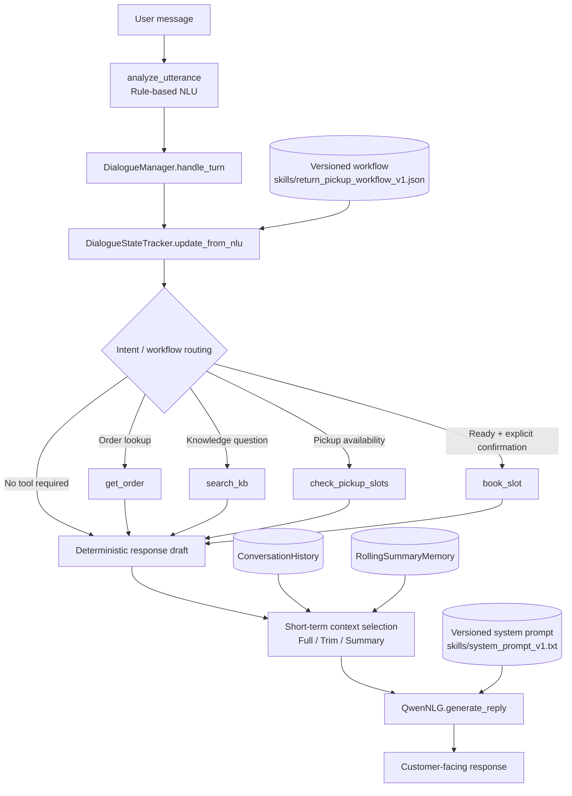

# Task 2 — Dialogue Pipeline and Short-Term Memory

**Project:** RecallBot V05 — E-commerce Orders and Returns  
**Variant:** V05  
**Context-window constraint:** 2,048 tokens  
**Configured chat model:** `qwen3:1.7b` through Ollama  
**Task status:** Task 2(a), 2(b) and 2(c) implemented and evidenced.

> This document records implementation and measured evidence for Task 2. NLU accuracy is measured on the labelled scripted set, separately from unit-test counts.

---

## 1. Requirement mapping

| Assignment requirement | Implementation/evidence | Status |
|---|---|---|
| 2(a): NLU, State Tracker, Dialogue Manager, tools and NLG pipeline | Rule-based NLU, structured state tracker, Dialogue Manager, JSON-backed tools, hybrid KB retrieval and Qwen NLG | Implemented |
| 2(a): labelled NLU accuracy on at least 20 utterances | 40 labelled cases from `data/test_conversation.json`, turns 1–40; 40/40 intent and expected-entity outcomes correct | Complete; `results/nlu_accuracy.json` and `results/nlu_accuracy.csv` |
| 2(a): tracker fields, versioned procedural-memory files and decoding settings | Described in Sections 2–4 | Implemented; document evidence |
| 2(b): Full, Trim and Summary strategies with state tracking enabled | Three strategies integrated into the same Dialogue Manager | Complete |
| 2(b): independent Session A runs | Three separate 25-turn official runs, same dataset and seeded database | Complete |
| 2(b): input-token-per-turn plot and total tokens including summary calls | Stage 5 plot, CSVs, report and reproducible log-analysis script | Complete |
| 2(c): Session A probe accuracy, failed probes and information-loss turn analysis | Official probes P08/P10 reviewed on all three corrected transcripts; supplemental P01/P03 separated | Complete; see Task 2(c) artifacts |
| 2(c): state follow-ups, clarification and confirmation-gated database write evidence | Session A turn 15, Session B turn 37 test, and separate real tool integration tests documented | Complete; no replay booking is claimed |

## 2. Dialogue pipeline — Task 2(a)

### 2.1 Architecture

The online conversation flow is orchestrated by `DialogueManager.handle_turn()`. NLU extracts a primary intent and entities; the State Tracker updates workflow state; the manager routes the request to tools where required; and Qwen NLG produces a grounded customer-facing response from the deterministic draft, compact state and retrieved evidence.



The State Tracker is shared across the three short-term memory strategies. It receives every original user message and controls task slots, clarification, pending confirmation and write authorization. The selected history strategy changes only the conversation context supplied to NLG.

### 2.2 NLU approach

The NLU is **deterministic and rule-based**. `src/dialogue/nlu.py` uses normalisation, regular expressions and phrase/rule matching to assign one primary intent and extract project-specific entities. It does not call an LLM or an external classification service. Extracted entities include order identifiers, SKU/product codes, domain error/reference codes, dates, time windows and other workflow values.

State-dependent follow-ups are not expected to be resolved from the utterance in isolation. The Dialogue Manager and State Tracker interpret them against the already collected workflow state.

**Labelled-utterance accuracy result:**

- Evaluation set: `data/nlu_test_cases.json`, labelled from `data/test_conversation.json` turns 1–40.
- Number of labelled utterances: 40.
- Correct outcomes: 40/40, including each declared `expected_entities` value.
- Accuracy: **100%** on this scripted set.
- Verification: current `analyze_utterance()` results were compared with all 40 expected intents and expected entities; no mismatches. The retained summary is `results/nlu_accuracy.json` (also represented in `results/nlu_accuracy.csv`).

This is measured accuracy on the supplied labelled set, not an estimate of performance on unseen traffic.

### 2.3 Dialogue State Tracker fields

The tracker maintains the following structured state (field values evolve over the workflow):

| Field | Purpose |
|---|---|
| `session_id` | Identifies the conversation session. |
| `user_id` | Identifies the customer. |
| `turn` | Current user-turn number. |
| `last_user_text` | Most recent user utterance. |
| `current_intent` | Intent assigned to the current utterance. |
| `current_entities` | Entities extracted from the current utterance. |
| `active_task` | Current workflow/task, such as `return_pickup`. |
| `task_status` | Workflow status, e.g. idle, collecting slots, confirmed or completed. |
| `slots` | Collected workflow values, including order, item, reason, pickup date/window/address and explicit confirmation. |
| `missing_slots` | Required slots that have not yet been collected. |
| `available_order_items` | Items available for selection from the verified order. |
| `clarification_required` | Indicates whether the user must clarify an ambiguous request. |
| `clarification_prompt` | The question to ask to resolve the ambiguity. |
| `pending_confirmation` | Indicates that a concrete proposed action is awaiting confirmation. |
| `confirmation_status` | Confirmation lifecycle, e.g. not requested, confirmed or cancelled. |
| `pending_action` | The specific action payload awaiting confirmation. |
| `database_write_authorized` | Authorization guard for the write operation. |
| `last_tool_result` | Most recent tool result used by the workflow. |

The tracker prevents `explicit_confirmation` from being set through ordinary slot assignment. Confirmation must arrive as a separate user turn while a specific pending action exists. The tool gateway independently verifies explicit confirmation, order ownership, SKU membership and current slot availability before writing a booking.

### 2.4 Procedural memory and prompts

The project stores its runtime procedural instructions as versioned files:

- `skills/system_prompt_v1.txt` — customer-facing assistant persona, scope, response constraints, grounding and safety instructions.
- `skills/return_pickup_workflow_v1.json` — versioned return/pickup workflow steps and required slots.

`QwenNLG` loads these files at initialization. They are not replaced by a hard-coded task prompt in the normal response path.

The prompt rules instruct Qwen to:

- stay within the ShopSphere orders, delivery, returns and refund domain;
- use the supplied deterministic draft, structured state and tool/retrieval evidence;
- answer policy questions only from supplied active/current evidence;
- avoid inventing order facts, availability, policy terms or outcomes;
- preserve order IDs, SKUs, dates, times, references and numeric values;
- avoid claiming that a tool action occurred unless the tool result confirms success;
- return only the customer-facing response and omit analysis or an independent citations footer (the application appends canonical citations).

### 2.5 Model and decoding configuration

The configured local chat model is `qwen3:1.7b` via Ollama. The V05 context window is 2,048 tokens.

| Turn type | Temperature | Top-p | Context (`num_ctx`) | Max output (`num_predict`) | Rationale |
|---|---:|---:|---:|---:|---|
| Task turns | 0.0 | 0.9 | 2,048 | 160 | Deterministic, controlled task execution and grounded responses. |
| Open turns | 0.3 | 0.9 | 2,048 | Slightly more natural conversational phrasing while retaining the same domain constraints. |

The customer-facing model, system prompt and decoding presets were kept the same across Full, Trim and Summary experiments. The Summary strategy adds a separate summary-generation invocation; it does not replace the customer-facing model call.

---

## 3. Short-term memory strategies — Task 2(b)

### 3.1 Strategy definitions

The project stores completed user/assistant exchanges in `ConversationHistory`. The implementation uses one completed user message plus its assistant reply as the unit of a conversational turn.

| Strategy | Context passed to customer-facing Qwen call | Implementation |
|---|---|---|
| Full | Whole completed conversation history | `ConversationHistory.get_history("full")` |
| Trim | Last 3 completed exchanges (`k = 3`) | `ConversationHistory.get_history("trim")` |
| Summary | Rolling summary plus last 2 completed exchanges; current user message is supplied separately | `RollingSummaryMemory.update_summary()` and `RollingSummaryMemory.get_context()` |

The summary is written by a second Qwen LLM call. It receives the previous summary and newly aged completed exchanges. It does not summarize the two recent exchanges that remain available separately. Summary calls are logged with `config=summary`, `call_type=summary`; customer-facing response calls use `config=summary`, `call_type=chat`.

All three strategies share the same State Tracker and tool-routing path. Summary redaction applies to the short-term transcript and summary context; it is not represented as deletion from persistent semantic or episodic stores.

### 3.2 Controlled Session A experiment

The evaluation runner reads the original user messages from `data/test_conversation.json` and validates Session A turn numbers 1–25. Each strategy is run independently with a fresh Dialogue Manager, State Tracker, conversation history and (for Summary) rolling-summary memory. The runtime pickup database is reset from the same immutable seed before each run; the reset fingerprints matched.

| Strategy | Official run ID | User turns processed | Chat fallbacks | Successful customer-facing Qwen calls | Summary-generation calls |
|---|---|---:|---:|---:|---:|
| Full | `task2b_full_run3` | 25/25 | 12 | 13 | 0 |
| Trim | `task2b_trim_run2` | 25/25 | 3 | 22 | 0 |
| Summary | `task2b_summary_run2` | 25/25 | 9 | 16 | 22 |

All three replays used the same 25 original Session A user messages, user/session identity, model, system prompt, workflow, decoding presets, tools, retrieval configuration and seed database. The official replay transcripts and manifest are stored under `results/`.

There were 24 customer-facing prompt-budget fallbacks across the three runs: Full had 12 (turns 14–25), Trim had 3 (turns 18, 19 and 21), and Summary had 9 (turns 16–24). These failures occurred before an Ollama request was sent; the Dialogue Manager used its deterministic fallback and continued safely. All 22 Summary-generation calls succeeded.

No successful booking write occurred during these official memory-strategy replays. At the confirmation point, the explicit confirmation did not match the active tracked order/item, so the safety guard prevented the write. This is not evidence of a successful booking; the successful booking path must be evidenced separately under Task 2(c) using a valid, consistent confirmation flow.

### 3.3 Token and latency results

The Stage 5 analysis reads `logs/calls.jsonl` and filters only the three official run IDs. The reported logged totals include the project’s NLU, embedding and model-call input/output fields. Tool calls use the assignment convention of zero token counts. `retrieved_tokens` is reported separately and is not added again to `input_tokens`.

| Strategy | Logged input tokens | Logged output tokens | Logged total tokens | Exact Ollama input + output tokens | Successful chat / fallback |
|---|---:|---:|---:|---:|---:|
| Full | 53,116 | 313 | 53,429 | 22,091 | 13 / 12 |
| Trim | 42,220 | 773 | 42,993 | 36,778 | 22 / 3 |
| Summary | 52,815 | 3,127 | 55,942 | 37,016 | 16 / 9 |

Summary-generation overhead was:

| Summary-call component | Tokens |
|---|---:|
| Input tokens | 8,197 |
| Output tokens | 2,706 |
| Total summary overhead | **10,903** |
| Successful summary calls | **22** |

The analysis distinguishes attempted prompt input from actual Ollama usage. A prompt-budget failure logged an attempted input size but was not sent to Ollama, and therefore is not counted as model-processed usage in the exact Ollama total. This explains why Full's exact Ollama total is comparatively low: 12 customer-facing prompts were rejected before inference. The result must not be interpreted as proof that Full is inherently the most token-efficient strategy.

Trim had the lowest logged total and fewest prompt-budget fallbacks in this Session A run. Summary preserved an older conversation summary but incurred 10,903 additional summary-generation tokens. These token results measure usage and fallback behavior; they do not establish answer quality or probe accuracy.

### 3.4 Stage 5 artifacts

| Artifact | Path |
|---|---|
| Required input-token-per-turn plot | `results/task2b_input_tokens_per_turn.png` |
| Strategy token summary | `results/task2b_token_summary.csv` |
| Per-turn token data | `results/task2b_token_per_turn.csv` |
| Stage 5 report | `results/task2b_stage5_report.md` |
| Reproducible analysis script | `scripts/analyze_task2b_logs.py` |
| Official Session A run manifest | `results/task2b_session_A_run_manifest.json` |
| Full transcript | `results/task2b_full_session_A_task2b_full_run3.json` |
| Trim transcript | `results/task2b_trim_session_A_task2b_trim_run2.json` |
| Summary transcript | `results/task2b_summary_session_A_task2b_summary_run2.json` |

Reproduce the analysis (without rerunning Session A) from the project root:

```powershell
.\.venv\Scripts\python.exe scripts\analyze_task2b_logs.py
```

The script validates the official run IDs, transcript turn counts, configuration/call-type consistency, duplicate call records, summary metadata, tool token fields and database reset fingerprints. It regenerates the CSV and chart artifacts from the retained runtime logs.

### 3.5 Reproducibility and limitations

- The official evaluation runs are `task2b_full_run3`, `task2b_trim_run2` and `task2b_summary_run2`. Earlier runs and the interrupted Full attempt are retained in the append-only log but are not included in the official Stage 5 comparison.
- The same 25 Session A messages and initial database seed were used for all strategies.
- Full and Summary encountered prompt-budget failures. These fallbacks are included in the reported experiment rather than removed from the results.
- No successful booking write occurred in these official runs. The booking safeguard prevented an unmatched confirmation from authorizing a write.
- The token comparison is not an answer-quality evaluation. Probe correctness and information loss are addressed under Task 2(c).
- The assignment's five Surprise Probes and later Task 4 configurations are outside this Task 2(b) evaluation.

---

## 4. Task 2(c) — Context-handling analysis

**Status: Complete, with the limits below.** Three corrected Session A replays processed 25/25 original messages each using fresh tracker/history state and the same reset seed fingerprint. Run IDs: `task2c_full_snapshot1`, `task2c_trim_snapshot1`, and `task2c_summary_snapshot1`. Snapshot and transcript paths are indexed in `results/task2c_session_A_run_manifest.json`; snapshots are under `results/task2c_snapshots/`.

### 4.1 Official Session A probes

The official Session A probe inventory contains P08 (turn 18, ERR-RMA-04) and P10 (turn 15, after-6-pm pickup follow-up). All three strategies answered both correctly: **2/2 (100%) per strategy; 6/6 evaluated rows**. P08's recorded answer explains that the return reason is missing or invalid, cites the retrieved active KB-007 evidence, and has no material factual error. Its deterministic fallback was triggered by prompt-budget overflow; the answer remains grounded and correct. P10 preserved 28 November 2026, merged the after-6-pm constraint into the active pickup request, checked live slot availability, and offered both returned options for customer selection. Full used a deterministic fallback for P10 as well, with the options intact. The six reviewed rows, actual answers and evidence are in `results/task2c_probe_results.csv`.

No official probe failed in this dataset. The official two-probe set does not test old-fact recall, so no strategy-specific failed official probe or causal source turn can be reported honestly.

### 4.2 Supplemental memory diagnostics

P01 (updated delivery window, expected 19:00–21:00) and P03 (current routine channel, expected SMS) are Session B definitions used only as explicitly supplemental short-term-memory diagnostics on the Session A snapshots. They are not counted in official Session A accuracy and do not establish persistent-memory behavior. Raw outcomes, context, summary text and call metadata are in `results/task2c_supplemental_memory_diagnostics.json` and `results/task2c_supplemental_runs/`.

- **Full:** both probes stopped before Ollama because full context exceeded the safe prompt budget (3,035 and 3,031 tokens versus 1,888). These are context-budget failures, not semantic-recall failures.
- **Trim:** P01 answered with the active return pickup’s “after 6 pm” detail; P03 supplied pickup details instead of SMS. The selected raw history was turns 23–25 and excluded source turns 19 and 20. The shared tracker still carried return-workflow state, which contaminated the unrelated direct prompt; that is supported by captured prompt context, though the model's internal cause is necessarily inferred.
- **Summary:** the actual final stored summary omits both the updated `19:00–21:00` window and SMS. P01/P03 responses substituted return-pickup facts and included unsupported pickup-confirmation/processing claims. The summary cursor reached 22. Intermediate summary versions were not retained, so the exact update where each fact was first lost is unknown.

These are supplemental diagnostic outcomes and do not revise official probe accuracy. Trim’s responses demonstrate failures with the tested context: the selected history omitted source turns 19 and 20, while the shared tracker still supplied unrelated return-workflow details. Summary’s responses demonstrate failures with the captured final summary: the updated delivery window and SMS were absent. For Full, P01 and P03 could not be judged semantically because prompt preparation exceeded the safe budget and Ollama was never called; this is a context-budget failure, not evidence that Full forgot either fact. No original source turn can honestly be identified as a Full memory-loss turn from these diagnostics.

### 4.3 First Trim eviction and state evidence

An exchange is one completed user/assistant pair; the incoming user message is supplied separately. The earliest Session A user fact is the preferred-name request at turn 2. At incoming turn 6, the last three completed exchanges are turns 3–5, so turn 2 is the first fact to leave Trim's selected history. The email preference at turn 4 leaves later, at incoming turn 8, when the selected completed exchanges are turns 5–7. Thus turn 8 is the eviction point for email, not for the earliest fact. Neither eviction is the same as an incorrect official probe result.

Turn 15's before/after tracker state, NLU extraction, actual scheduler results and response are in `results/task2c_state_followup_and_clarification.md` and the P10 rows of the probe CSV. Session B turn 37 asks “Can you book a pickup for the other item as well?” The isolated regression test verifies the exact clarification “Which order and item do you mean? Please provide the order ID or select an item.” with no order/SKU and no tool call. This is test evidence, not a Session B runtime replay. Session B turn 33 is labelled a state follow-up. The focused test replays turns 31–33 with fresh Session B state and KB evidence; it verifies a conditional general process answer, not a runtime Qwen response. A pickup-specific status would require Task 3 persistent episode memory, which is not simulated.

### 4.4 Booking safeguard evidence

The historical Task 2(c) replay databases contain no booking: the customer did not choose between the available windows and no valid pending slot action existed. The separate real tool-gateway integration tests demonstrate the write path: multiple matches require a selection; a selected slot and full order/item/date/window/slot ID are stored in a pending action and repeated in the confirmation summary; no write occurs until a matching explicit confirmation; the JSON runtime database then contains the booking. A mismatched confirmation is rejected, and duplicate booking is refused. See `results/task2c_booking_confirmation_evidence.md` and the named tests in `tests/test_live_tool_integration.py`, `tests/test_dialogue_manager.py`, `tests/test_tools.py`, and `tests/test_state_tracker.py`.

### 4.5 Scope and limitations

- Official accuracy is based on only P08/P10; it should not be generalized as overall answer quality.
- Full's supplemental prompts exceeded budget before inference.
- Summary's final content shows omissions and malformed nested summary text; missing intermediate snapshots limit exact loss-turn attribution.
- Session B turn 33 was not run as a runtime replay; its isolated integration test verifies a general KB-grounded answer from turns 31–33. Session B turn 37 was unit-tested in isolation.
- Official Task 2(c) inference used real Qwen/Ollama. Booking integration tests used an isolated temporary JSON database; they do not change the replay outcome.

## 5. Task 2 completion status

| Subtask | Current status |
|---|---|
| Task 2(a) — Pipeline, prompts, procedural memory and labelled NLU | **Complete** — 40/40 labelled scripted utterances (100% intent and expected-entity outcome). |
| Task 2(b) — Short-term memory strategies | **Complete** — three strategies, independent 25-turn Session A replays, token plot, token totals and reproducible analysis. |
| Task 2(c) — Context-handling analysis | **Complete** — official probe review, separated supplemental diagnostics, eviction analysis, state/clarification and booking evidence. |

The Task 2(c) results and limitations are reported without claiming that the historical replay booked a pickup or that the small official probe set measures generalization.


## Day 3 — Task 2 Summary

Implemented and evaluated the complete conversational dialogue pipeline and short-term memory strategies for RecallBot V05.

### Task 2(a) — Dialogue Pipeline
- Rule-based NLU and entity extraction.
- Dialogue State Tracker.
- Dialogue Manager and tool integration.
- Qwen NLG through Ollama.
- Explicit confirmation-gated booking workflow.
- Labelled NLU evaluation: 40/40 correct.

### Task 2(b) — Short-Term Memory
- Full conversation history.
- Trim history (k = 3).
- Rolling summary + last 2 exchanges.
- Independent Session A evaluations.
- Token accounting, comparison chart and reproducible analysis.

### Task 2(c) — Context Handling
- Official probe evaluation.
- Supplemental memory-retention diagnostics.
- Trim information-loss analysis.
- State follow-up and clarification handling.
- Booking confirmation and database-write verification.

### Validation
- Full regression suite: 178 tests passed.
- Documentation and evaluation artifacts updated.

This completes Day 3 — Task 2(a), 2(b) and 2(c).