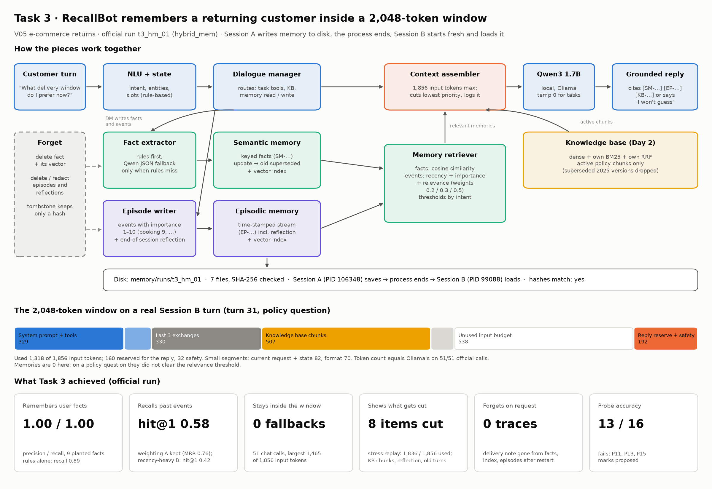

# Task 3 — Retrieval and Long-Term Memory



*Figure: Task 3 at a glance. Every number in the figure is read from `logs/calls.jsonl` and `results/` by `scripts/make_task3_summary_figure.py`; regenerate it after any rerun.*

**Project:** RecallBot V05 — E-commerce orders and returns
**Twist:** E — small context window (2,048 tokens), trim k = 3
**Chat model:** `qwen3:1.7b` (Ollama) · **Embeddings:** `BAAI/bge-small-en-v1.5`, 384-d, CLS pooling
**Design:** [`docs/design/Task-3-Long-Term-Memory-Design.md`](../design/Task-3-Long-Term-Memory-Design.md)

Every number below is reproducible from `logs/calls.jsonl` or the listed results file. Run IDs used:

| Run ID | Purpose | Status |
|---|---|---|
| `t3_hm_pilot_A`, `t3_hm_pilot_B` | Pilot of the full A → B flow | **Pilot only**; surfaced the defects in §7 |
| `t3_calibration` | Memory-threshold calibration on pilot memory | Evidence for §3, §4 thresholds |
| **`t3_hm_01_A`, `t3_hm_01_B`** | **Official hybrid_mem Session A and B** | **Reported results** |
| `t3_hm_01_weighting` | Episodic weighting comparison (§4.3) | Reported |
| `t3_hm_01_budget_stress` | First stress replay; included superseded chunks the real DM filters out | Superseded by `…stress2` |
| `t3_hm_01_budget_stress2` | Twist E stress replay (§6) | Reported |

---

## 3(a) Chunking and indexing — complete (Day 2)

Two chunk sizes (128 and 512 Qwen3 tokens), 15% token-counted overlap, BGE CLS-pooled embeddings, metadata (doc ID, section, version, effective dates, status) per chunk, and an exact flat NumPy index justified by corpus size (84 and 24 chunks). See the README's *Retrieval design decisions* section and `index/dense_*/index_manifest.json`.

## 3(b) Dense, BM25 and hybrid — complete (Day 2)

Own BM25 and RRF with the CS4 worked-example tests (`tests/test_bm25.py`, `tests/test_rrf.py`); hit rate @1/@3/@5 for 3 methods × 2 sizes with code and paraphrase rows (`results/hit_rate.csv`, `results/hit_rate_summary.csv`); fixed and unfixed cases Q014 and Q023 with ranked lists (`results/retrieval_rankings.csv`). Details in the README.

---

## 3(c) Semantic memory of the user

**Implementation.** `src/memory/semantic_memory.py` stores keyed records

```json
{"memory_id": "SM-0008", "user": "CUST-MAYA-1042", "key": "preferred_delivery_window",
 "value": "19:00-21:00", "source_turn": 19, "session": "A", "date": "2026-11-21T10:36:00+05:30",
 "status": "active", "supersedes": "SM-0005", "extraction_method": "rule", "rule_id": "FX-TIME-WINDOW"}
```

plus a deletable flat cosine index of active facts (`src/memory/vector_store.py`). Files: `memory/runs/t3_hm_01/semantic_facts.json`, `semantic_vectors.npy`, `semantic_index.json`.

**Extraction** (`src/memory/fact_extractor.py`, logged as `call_type=extract`):
1. Rules map the Day 3 NLU entities to canonical keys (no rule was written for a specific scripted sentence).
2. Only if a *fact-like* turn yields nothing, Qwen is asked for JSON; its output is validated (key format, value grounded in the message, ≤ 80 chars, no secrets) before storage.
3. Greeting, small talk, closing and confirmations never reach extraction.

**Precision and recall** against the 9 planted Session A facts (`results/task3_semantic_memory_metrics.json`, produced by `scripts/evaluate_semantic_extraction.py` from the official run's files and log only):

| Extractor | Predicted | Correct | Precision | Recall | Missed |
|---|---:|---:|---:|---:|---|
| Rules only | 8 | 8 | 1.00 | 0.89 | turn 8 `return_method_preference` ("a pickup from my home") |
| **Rules + Qwen fallback** | 9 | 9 | **1.00** | **1.00** | — |

The Qwen fallback ran on exactly one turn (turn 8). Filler turns 1, 3, 11 and 25 produced **no records and no extraction attempts**. Match rule: same key and source turn, and the content words of one value contained in the other ("pickup from home" ≡ "home pickup"). The deleted delivery note is verified through the tombstone fingerprint (its value is not stored anywhere). *Caveat:* the rules were written with this scripted conversation available, so 100% on 9 facts is optimistic and does not estimate unseen-traffic accuracy.

**Update supersedes.** Turn 19 marks SM-0005 (18:00-21:00) `superseded` and removes its vector; turn 20 does the same for email → SMS. Session B P01, P03 and turn 27 return only the new values.

**Forget deletes from store and index** (turn 24, `MemoryManager.forget`): every `delivery_note` record and its vector are deleted, the linked preference episode is deleted, any other episode or reflection mentioning the value is redacted and re-embedded, and a tombstone keeps only a SHA-256 fingerprint. After the restart, `grep -ril "side door" memory/runs/t3_hm_01/` and the Session B transcript return nothing; P04 and turn 30 answer "I no longer keep your delivery note. It was deleted at your request…".

**Retrieval thresholds** (calibrated on the *pilot* memory, then fixed; `results/task3_threshold_calibration.json`). No single cosine threshold separated relevant from irrelevant fact queries (lowest relevant 0.663 for P16, highest irrelevant 0.704 for turn 21), so the threshold is intent-dependent: explicit memory questions ≥ 0.60 (facts) / 0.50 (episodes); all other turns ≥ 0.72 / 0.80, above every calibration negative. P09 ("pet's name" vs preferred name, 0.588) passes by only 0.012 — a stated risk.

## 3(d) Episodic memory

**Stream.** `memory/runs/t3_hm_01/episodes.json` — 14 time-stamped episodes after Session A, each with type, description, entities, linked memory IDs and a **rule-based importance** (logged as `call_type=importance`): booking 9, complaint 8, decision 7, reflection 6, task event 5, preference update 4, preference/forget event 3; small talk (1) is below the write threshold (3). Episodes come from real handlers: complaint (turn 10, no invented case ID), return started (12), decision (17), booking with the real `RMA-20261126-69EC2A24` from `book_slot` (23), forget event (24, key only).

**Score.** `score = w_r·R̂ + w_i·Î + w_s·Ŝ` with `R = 0.995^hours` on a logical session clock (Session A from 2026-11-21 10:00, +2 min/turn; Session B from 2026-11-24 10:00), `I = importance/10`, `S` = BGE cosine; each component min-max normalised over the candidates (`src/memory/episodic_memory.py`).

**Weighting comparison** on the 3 E probes + 9 more episodic queries (`data/episodic_queries.json`), official Session A memory, Session B clock (`results/task3_episodic_weight_comparison.csv/.json`):

| Weighting (recency / importance / relevance) | hit@1 (12) | MRR | E-probe hit@1 (3) |
|---|---:|---:|---:|
| **A — relevance-focused (0.20 / 0.30 / 0.50)** | **0.583** | **0.757** | **0.667** |
| B — recency-focused (0.40 / 0.30 / 0.30) | 0.417 | 0.607 | 0.333 |
| C — equal (⅓ / ⅓ / ⅓) | 0.417 | 0.646 | 0.333 |

**Kept: A.** All Session A episodes lie within 50 minutes, but min-max normalisation stretches that spread to [0, 1], so recency-heavy weightings let the latest high-importance booking (EP-0013) win almost every query. A still misses Q-E03/P13 (decision ranked 3rd) — see the P13 failure below.

**Reflection.** At the end of Session A one `reflect` call wrote EP-0015 (importance 6, linked to the complaint, return, decision, booking and preference-update episodes). Session B retrieves it: it is in the prompt at turn 27 and for P01, P02, P03, P05, P13, P16 (context-assembly records in `results/task3_sessions/t3_hm_01_session_B.json`); in the pilot it answered P13 directly. Session B creates no new notable episode (importance ≥ 4), so no Session B reflection is written — by design, not an error.

**Forget after restart.** EP-0004 (the delivery-note preference event) was deleted at turn 24; no episode or reflection contains the value after the restart (§3(c)).

## 3(e) Context engineering

`src/context/context_assembler.py` builds every Task 4-config prompt. Budget: **2,048 − 160 (reply reserve) − 32 (safety) = 1,856 input tokens** (open turns reserve 128 → 1,888). Counting uses the Qwen3 chat template plus the measured Ollama offset of 8 tokens (empty `<think>` block): on all **51 official chat calls the assembler's count equals Ollama's `prompt_eval_count` exactly**. Mandatory items (system prompt v2, tools, current workflow step, user turn, dialogue state, draft) always go in; memories, KB chunks and history follow an intent-dependent priority and are cut whole; every cut is logged in the chat call's `extra.context_assembly`.

**Official Session B turn 27** — "What delivery window do I currently prefer?" (`results/task3_context_assembly.json`):

| Component | Tokens | Memory type | Home | IDs |
|---|---:|---|---|---|
| System prompt `system_prompt_v2` | 274 | procedural | external file `skills/` → prompt | system_prompt_v2 |
| Tools | 55 | procedural | model-native (prompt) | TOOLS |
| Conversation history (last 3 within the session) | 36 | short-term | model-native | HISTORY-1 |
| Current task (user turn, state, draft) | 66 | working | model-native | USER-TURN, STATE, DRAFT |
| Long-term memory | 456 | semantic + episodic | external stores + vector indexes | SM-0008, SM-0003, SM-0006, EP-0011, EP-0015 (reflection), EP-0013 |
| Retrieved knowledge | 0 | — | — | — |
| Chat template and headings | 51 | — | model-native | — |
| **Total input** | **938 / 1,856** | | | **+160 reserved for the reply** |

Turn 31 (KB question) for comparison: system 274, tools 55, history 330, current task 82, KB chunks 507 (KB-002-C128-0002/-0003/-0001, all active), template 70 → **1,318 / 1,856**.

**Grounding rules** (`skills/system_prompt_v2.txt`): customer facts only from `[SM-…]`, events only from `[EP-…]`, policy only from active `[KB-…]` chunks; cite every ID used; the draft is authoritative for actions and references; never reveal forgotten data. Memory IDs are protected values: if the model drops them the deterministic draft (with IDs) is used. **Exact fallback sentence** (emitted by the dialogue manager, never by the model; P09):

> I don't have that information in my saved details or the ShopSphere knowledge base, so I won't guess.

## 3(f) Twist E — small context window

**Mechanism.** (1) the compact v2 prompt: v1 + full workflow JSON cost 1,095 tokens (59% of the input budget) and caused Task 2's 24 budget fallbacks; v2 + tools + the current workflow step costs ≈ 330–390; (2) budgeted assembly with whole-item cuts and a drop log; (3) trim k = 3 for short-term history while long-term facts remain retrievable. Result: **0 budget fallbacks in 51 official chat calls**; largest official prompt 1,465 tokens.

**What gets cut.** In the official run nothing beyond the trim window needed cutting. To demonstrate the budget decision, `scripts/context_assembly_report.py` replays real Session B turn 31 with 512-token chunks, top-5 active KB hits, memory at the memory-question thresholds and the **full** Session B history (run `t3_hm_01_budget_stress2`):

| Kept (1,836 / 1,856 input tokens) | Cut (reason: would exceed 1,856) |
|---|---|
| system 274, tools 55, current task 82 | KB-004-C512-0001 (553), **KB-002-C512-0002 (302 — would reach 1,858)**, KB-013-C512-0001 (547) |
| KB-002-C512-0001, KB-009-C512-0001 (1,106) | EP-0015 reflection (148) |
| SM-0008, EP-0013, EP-0010 (226) | HISTORY-1 … HISTORY-4 (36 / 48 / 148 / 146) |
| HISTORY-5, the newest exchange (36) | |

From the Task 4 run onwards, each chat call also records the exchanges removed by trim (`dropped_by_trim`).

**Twist probes (official `t3_hm_01`):**

| Probe | Result | Explanation |
|---|---|---|
| P16 — recall the latest delivery preference though older than the last 3 turns | **Pass** | 19:00-21:00 retrieved from persistent memory; turn 19 was outside the trim window. |
| P15 — what RecallBot does when the context exceeds 2,048 tokens | **Fail** | The draft stated the budget policy correctly; Qwen rewrote it as "ask for the next missing detail" (NLG fault). |

**Change after the official run (before/after reported separately, per Task 4(c) practice):** the budget answer is now verbatim and quotes the previous turn's live numbers ("used N of 1,856 input tokens and M item(s) were cut"). It is exercised by the Task 4 `hybrid_mem` run, which will be reported as the *after* result; `t3_hm_01` stays the raw *before*.

---

## Session B in a separate process

`python -m src.dialogue.run_session` runs one session per process. `memory/runs/t3_hm_01/session_manifest.json`:

| | Session A | Session B |
|---|---|---|
| PID | 106348 | 99088 |
| Run | 18:06:23 → 18:08:33 | 18:08:57 → 18:11:20 |
| Memory files | saved: 7 files with SHA-256 | **loaded hashes = Session A saved hashes** (`loaded_hashes_match_session_a: true`) |

Session B refuses to start without a complete Session A manifest and aborts if any memory file changed in between.

## Probe results — official `t3_hm_01` (manually judged)

Marks reviewed by the student in `results/task3_probe_judgements.json` and written to `results/probe_results.csv` (`judged_by=manual`) by `scripts/build_probe_results.py`; answers are copied from the run transcripts.

| Category | Probes | Correct |
|---|---|---:|
| R semantic recall | P01, P02 | 2/2 |
| U updated | P03 | 1/1 |
| F forgotten | P04 | 1/1 |
| E episodic | P05, P06, P13 | 2/3 |
| K knowledge base | P07, P08, P14 | 3/3 |
| N not available | P09, P12 | 2/2 |
| S state follow-up | P10, P11 | 1/2 |
| Twist E | P15, P16 | 1/2 |
| **Total** | | **13/16** |

Failures (inputs for Task 4(b)): **P13** episodic-scoring fault (decision EP-0010 ranked 3rd under weighting A); **P11** retrieval fault (KB-003 refund-stages chunk not retrieved; the model then said the carrier inspects the item); **P15** NLG fault (above). Also observed: P07 is correct but adds a contradictory sentence; turn 36 (cancellation eligibility) has had no dedicated handler since Day 3.

## 7. Pilot findings fixed before the official run

| Pilot observation | Fix |
|---|---|
| The assembler recorded 2 tokens per prompt (transformers 5.x returns a `BatchEncoding`) | Count `input_ids`; plausibility test. Ollama confirmed no pilot prompt exceeded the budget (max 1,506). |
| Calibration: the delivery window leaked into pickup slot-filling (turn 14) | Intent-dependent thresholds (§3(c)) |
| Qwen read out the idle state as "Missing details: customer_id…" | State in the prompt only while a task is active |
| Superseded KB-001 chunks entered a 2026 question (turn 31) | Task 4 configs drop superseded chunks unless the question asks about an older period |
| Third-person drafts shown when the model dropped citation IDs | Second-person drafts |

## Reproduction

```powershell
python -m pytest tests/ -q                                   # 226 tests, no model calls
python -m src.dialogue.run_session --session A --config hybrid_mem --experiment <id>
python -m src.dialogue.run_session --session B --config hybrid_mem --experiment <id> --weighting A
python scripts/compare_episodic_weightings.py --experiment <id>
python scripts/evaluate_semantic_extraction.py --experiment <id>
python scripts/context_assembly_report.py --experiment <id> --run-id <id>_budget_stress
python scripts/build_probe_results.py --judgements results/task3_probe_judgements.json
```

New run IDs must be used for new runs; the logger and the session runner refuse to reuse an existing run ID or memory directory.
