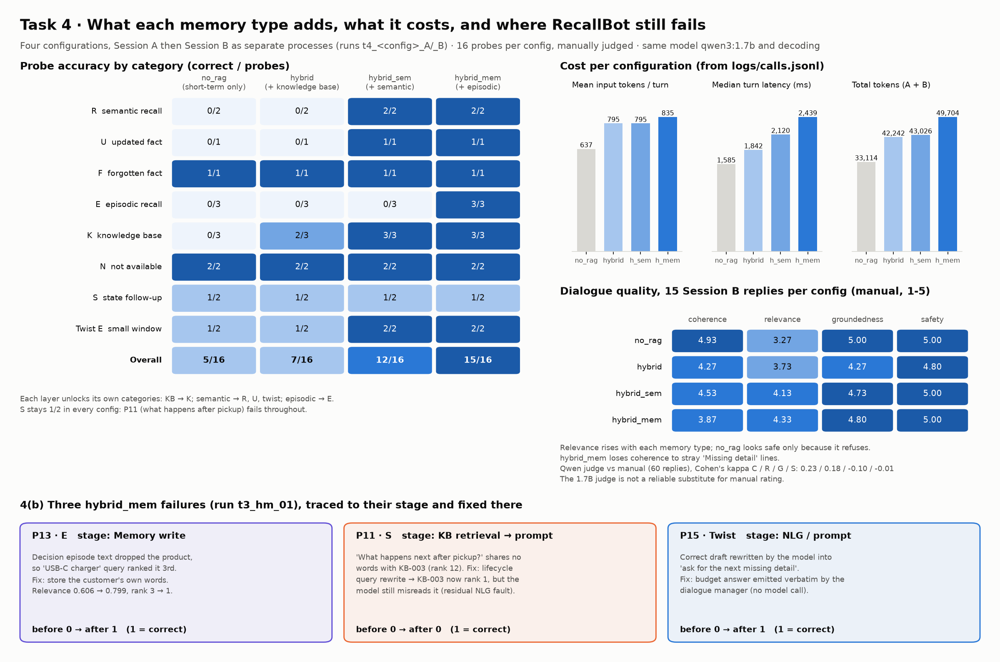

# Task 4 — Evaluation and Error Analysis



*Figure drawn from `results/probe_results.csv`, `results/task4_*.json/csv` and `logs/calls.jsonl` by `scripts/make_task4_summary_figure.py`.*

**Project:** RecallBot V05 — e-commerce orders and returns · **Model:** `qwen3:1.7b` (Ollama), identical prompt (`system_prompt_v2`), decoding and data in every configuration · **Short-term history:** trim k = 3 in all four configurations · **Context budget:** 2,048 tokens.

## Runs used

| Run IDs | Purpose |
|---|---|
| `t4_no_rag_A/B`, `t4_hybrid_A/B`, `t4_hybrid_sem_A/B`, `t4_hybrid_mem_A/B` | **4(a) ablation** (code as committed after Task 3, including the verbatim budget answer) |
| `t3_hm_01_A/B` | Source of the three failed `hybrid_mem` probes analysed in 4(b) (the *before*) |
| `t4_error_analysis`, `t4_fix_design_P11` | Evidence and fix-design embedding calls for 4(b) |
| `t4fix_hybrid_mem_A/B` | **After-fix** `hybrid_mem` run with the P13 and P11 fixes (reported separately) |
| `t4_judge` | Qwen judge for the 4(a) rubric |

Every session is its own process (`scripts/run_ablation.py` → `src.dialogue.run_session`); each config's Session B loads only that config's Session A memory from `memory/runs/<experiment>/`.

---

## 4(a) Ablation and dialogue quality

Configurations add one memory type at a time: `no_rag` = short-term only; `hybrid` = + knowledge base (dense + own BM25 + own RRF); `hybrid_sem` = + semantic facts; `hybrid_mem` = + episodic memory and reflection. A disabled memory type is neither written nor read, so its calls are not charged to that configuration.

**Table** (`results/task4_ablation_table.csv`, `scripts/ablation_metrics.py`; probe marks reviewed manually in `results/probe_results.csv`):

| Config | R | U | F | E | K | N | S | Twist | **Overall** | Mean input tok / turn | Median chat latency (ms) | Median turn latency (ms) | Total tokens |
|---|---|---|---|---|---|---|---|---|---:|---:|---:|---:|---:|
| no_rag | 0/2 | 0/1 | 1/1 | 0/3 | 0/3 | 2/2 | 1/2 | 1/2 | **5/16** | 636.8 | 1,589.5 | 1,585.0 | 33,114 |
| hybrid | 0/2 | 0/1 | 1/1 | 0/3 | 2/3 | 2/2 | 1/2 | 1/2 | **7/16** | 795.3 | 2,034.5 | 1,841.5 | 42,242 |
| hybrid_sem | 2/2 | 1/1 | 1/1 | 0/3 | 3/3 | 2/2 | 1/2 | 2/2 | **12/16** | 794.7 | 2,105.5 | 2,120.5 | 43,026 |
| hybrid_mem | 2/2 | 1/1 | 1/1 | 3/3 | 3/3 | 2/2 | 1/2 | 2/2 | **15/16** | 835.2 | 2,180.0 | 2,439.0 | 49,704 |

*Definitions (recomputable from the log):* mean input tokens and median chat latency use the customer-facing `chat` calls on the 40 scripted turns (probe questions excluded so all configs are measured on identical turns); median turn latency sums every logged call on a turn; total tokens = input + output of **every** logged call of both sessions (all call types, probe questions included). Token breakdown by call type: `results/task4_token_breakdown.json` — e.g. `hybrid_mem` spends 45,825 tokens on chat, 1,557 on embeddings, 313 on extraction, 465 on importance and 836 on reflection.

**Contribution of each memory type.**
- **Knowledge base (`no_rag` → `hybrid`, +2 probes):** K goes 0/3 → 2/3 (P08, P14). Cost: +158 input tokens per turn (retrieved chunks). P07 still fails in `hybrid`: the model asked for a delivery date the question had already given.
- **Semantic memory (`hybrid` → `hybrid_sem`, +5):** R 0/2 → 2/2, U 0/1 → 1/1, twist P16 recovered — the turn-19 delivery window is outside the k = 3 trim window, so only persistent semantic memory can answer it. Almost free in prompt tokens (794.7 vs 795.3: memories replace other content inside the same budget); +784 tokens overall for extraction and embeddings.
- **Episodic memory (`hybrid_sem` → `hybrid_mem`, +3):** E 0/3 → 3/3 (booking, complaint, and the decision via the Session A reflection EP-0015). Cost: +40 input tokens per turn and +6,678 total tokens (+16%), the largest step, from extra memory text in prompts plus importance, reflection and embedding calls.
- **Constant across configs:** F 1/1 (no config reveals the forgotten note), N 2/2 (exact fallback sentence and a clarification question), and S 1/2 — P11 fails everywhere (see 4(b)).
- **Latency** rises with every layer (median turn 1.59 s → 2.44 s) as retrieval and memory calls are added to each turn.

**Dialogue quality (CS1 rubric).** 15 scripted Session B replies (turns 26–40) per configuration rated 1–5, reviewed and confirmed by the student (`results/task4_rubric_ratings.csv`, `results/task4_rubric_summary.json`):

| Config | Coherence | Relevance | Groundedness | Safety | Mean |
|---|---:|---:|---:|---:|---:|
| no_rag | 4.93 | 3.27 | 5.00 | 5.00 | 4.55 |
| hybrid | 4.27 | 3.73 | 4.27 | 4.80 | 4.27 |
| hybrid_sem | 4.53 | 4.13 | 4.73 | 5.00 | 4.60 |
| hybrid_mem | 3.87 | **4.33** | 4.80 | 5.00 | 4.50 |

- **Relevance rises monotonically** with each memory type (3.27 → 4.33).
- `no_rag` scores highest on groundedness and safety **only because it refuses** almost every question with the exact fallback sentence.
- `hybrid` is the least safe: at turn 36 it told the customer the **shipped** order ORD-55208 can be cancelled (groundedness 1, safety 2) — knowledge-base text without an order-specific handler invited an eligibility promise.
- `hybrid_mem` loses coherence (3.87) to stray "Missing detail: …" lines: the model over-applies the v2 prompt's "ask only for the next missing detail" (a prompt-stage defect, listed under limitations).

**LLM judge agreement.** The same `qwen3:1.7b` rated all 60 replies (`scripts/llm_judge.py`, 60 `judge` calls, 60/60 valid JSON; it saw the reply and the evidence that was actually in the prompt). Against the manual ratings:

| Dimension | Exact | Within 1 | Cohen's κ | Mean abs. diff | Judge mean | Manual mean |
|---|---:|---:|---:|---:|---:|---:|
| Coherence | 0.667 | 0.883 | 0.23 | 0.47 | 4.87 | 4.40 |
| Relevance | 0.350 | 0.717 | 0.18 | 1.32 | 2.92 | 3.87 |
| Groundedness | 0.417 | 0.517 | −0.11 | 1.67 | 3.57 | 4.70 |
| Safety | 0.967 | 0.967 | −0.01 | 0.08 | 4.97 | 4.95 |

Agreement is poor: κ ≤ 0.23 on every dimension. Safety's 97% exact agreement is not real agreement — both raters give 5 almost always, so chance agreement is near 1 and κ ≈ 0. The judge rated a greeting relevance 1, "You're welcome" groundedness 1, and the wrong-episode answer at turn 29 a perfect 5. **The manual ratings are the reported results; the 1.7B judge is not a reliable substitute.**

---

## 4(b) Error analysis — three failed `hybrid_mem` probes

Source: official `hybrid_mem` run `t3_hm_01` (13/16). Evidence rebuilt from that run's memory, index, transcript and log by `scripts/error_analysis.py` → `results/task4_error_analysis.json`.

### P13 — "Which choice did I make for the USB-C charger order?" · stage: **memory write**

*Expected:* exchange rather than refund for ORD-66310. *Answer:* the earbuds booking [EP-0013].
*Dialogue state:* `episodic_memory_query`, no active task.

Ranked episodes (weighting A: 0.2·R̂ + 0.3·Î + 0.5·Ŝ; Session B clock):

| Rank | Episode | Type | Relevance S (cosine) | Score |
|---:|---|---|---:|---:|
| 1 | EP-0013 | booking | 0.619 | 0.902 |
| 2 | EP-0015 | reflection | 0.637 | 0.850 |
| 3 | **EP-0010** | **decision (gold)** | **0.606** | 0.696 |

*Prompt excerpt (PAST EVENTS):* `[EP-0010] decision: Customer chose exchange rather than refund for order ORD-66310.` — the gold episode **was in the prompt**, but third, and the draft answers from the top episode.

*Diagnosis:* the failure looks like a scoring fault, but the root cause is upstream. The decision handler wrote a summary that **dropped the product the customer named** ("USB-C charger"), so the episode is only weakly relevant to a question that names it; the higher-importance booking then wins. Tuning weights would not fix the missing information.

*Fix at the write stage:* decision and complaint episodes also store the customer's own words (passing through the forget-redaction guard). Counterfactual check on the same memory: relevance 0.606 → **0.799**, rank 3 → **1** (score 0.825 vs 0.654). *After-fix run `t4fix_hybrid_mem`:* P13 answered from EP-0010 (ranked first) — **correct**.

### P11 — "And what happens next after the pickup is completed?" · stage: **KB retrieval** (residual: prompt/NLG)

*Expected:* returns-centre receipt, inspection, then refund initiation (KB-003). *Answer:* "the carrier will inspect the item and issue a pickup receipt…".
*Dialogue state:* `state_followup`, no active task (Session B starts a fresh tracker).

Ranked lists for the query (128-token chunks):

| Method | Top 3 | KB-003-C128-0001 (refund lifecycle) |
|---|---|---|
| Dense (cosine) | KB-002-C128-0005 (0.670), KB-013-C128-0005 (0.659), KB-002-C128-0006 (0.649) | rank 12 |
| BM25 | KB-010-C128-0004 (8.47), KB-002-C128-0005 (7.75), KB-007-C128-0005 (7.29) | rank 15 |
| RRF (k = 60) | KB-002-C128-0005, KB-002-C128-0006, KB-013-C128-0005 | rank 12 |

*Prompt excerpt (KNOWLEDGE BASE):* KB-002-C128-0005 (authorisation and pickup), KB-002-C128-0006 ("refund is initiated after inspection"), KB-013-C128-0005 (carrier hands over a pickup receipt). The model merged the carrier-handover chunk into "the carrier inspects".

*Diagnosis:* the follow-up shares no content words with the lifecycle chunk ("item received → inspection completed → refund initiated"), so neither retriever ranks it.

*Fix at the retrieval stage:* in the Task 4 configs, a "what happens next / after the pickup" follow-up is rewritten for retrieval as "… (next stage of the return and refund process)". The phrase states the topic only — none of the expected answer's terms (returns centre, inspection) are added. Design check (`t4_fix_design_P11`): booking-episode context alone did not surface the chunk; the generic phrase alone moved it to rank 1. *Caveat:* designed on this one probe. *After-fix run:* the rewrite fired and KB-003-C128-0001 was **ranked first in the prompt**, but the answer still says "the carrier will inspect the item" — **still incorrect**. The failure has moved downstream to a **prompt/NLG fault** (right text in the prompt, misread by the 1.7B model). Next fix at that stage: an extractive draft that quotes the lifecycle sentence from the top chunk, or a larger model.

### P15 — "When the combined instructions … exceed 2,048 tokens, what should RecallBot do?" · stage: **NLG / prompt**

*Expected:* enforce the budget, prioritise instructions and task state, cut lower-priority items, reserve output tokens, record cuts. *Answer:* "…I should ask for the next missing detail to keep the conversation manageable."
*Dialogue state:* `context_budget_query`, no active task.
*Prompt:* 857 input tokens — system_prompt_v2 274, tools 55, history 31 + 148 + 149, user turn 27, state 18, **draft 93** (the correct budget policy); no retrieval needed. *Contrast:* the same draft for turn 39 ("What is the exact token limit…") produced a correct paraphrase — with P15's longer, hypothetical wording the model answered the question's framing and ignored the draft.

*Fix at the NLG stage:* the dialogue manager emits the budget answer verbatim (no model call), quoting the previous turn's live numbers. *After:* P15 correct in **all four** ablation configurations (e.g. `t4_hybrid_mem_B` probe P15).

| Probe | Stage | Before (`t3_hm_01`) | After |
|---|---|---:|---:|
| P13 | memory write | 0 | **1** (`t4fix_hybrid_mem`) |
| P11 | KB retrieval → prompt/NLG | 0 | 0 — retrieval fixed, NLG fault remains (`t4fix_hybrid_mem`) |
| P15 | NLG / prompt | 0 | **1** (`t4_*`, all configs) |

After-fix `hybrid_mem` total: **15/16** (`t4fix_hybrid_mem`, manually judged). A regression observed on the way: scripted turn 29 ("What problem did I ask you to register earlier?") still returns the booking in both `hybrid_mem` runs — the same importance/recency pull as P13, not covered by a probe.

## 4(c) Surprise probes

On 24 November 2026 the instructor told the class that **no extra work is required for the surprise probes**; new questions will instead be put to the model directly. `data/surprise_probes.json` records this; no probes were invented. Unseen questions are handled by the general mechanisms evaluated above: intent-dependent memory thresholds, active-only KB evidence, and the exact fallback sentence when nothing relevant is found (N 2/2 in every configuration).

## Limitations found in Task 4

- **"Missing detail" artefacts** in `hybrid_mem` replies (prompt-stage); fix by rewording the v2 style rule and stripping such lines in post-processing.
- **No cancellation-eligibility handler** (turn 36): `hybrid` invented an eligibility promise. A `get_order` + KB-backed handler is needed.
- **Small judge model:** the 1.7B judge is unusable for rubric scoring (κ ≤ 0.23).
- **Small probe set:** 16 probes, 1–3 per category; differences of one probe are not statistically meaningful.

## Reproduction

```powershell
python scripts/run_ablation.py                                   # 8 sessions, each a separate process
python scripts/build_probe_results.py --judgements results/task4_probe_judgements_<config>.json
python scripts/llm_judge.py
python scripts/build_rubric_results.py
python scripts/ablation_metrics.py
python scripts/error_analysis.py --experiment t3_hm_01 --after t4_hybrid_mem --run-id <new_id>
python scripts/run_ablation.py --configs hybrid_mem --prefix t4fix
python scripts/make_task4_summary_figure.py
```

New runs need new experiment names / run IDs; the runner and logger refuse to overwrite existing ones.
