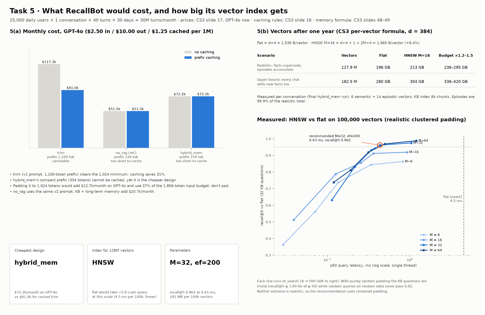

# Task 5 — Cost and Scale



*Figure generated from `results/task5_*.json/csv` by `scripts/make_task5_summary_figure.py`.*

**Variant V05 scale:** 25,000 daily users · **Model row used:** GPT-4o (OpenAI), CS3 Lecture 3 slide 17 · **Embedding model:** `BAAI/bge-small-en-v1.5`, d = 384.

<!-- TOC -->
## Table of contents

- [5(a) Token economics](#5a-token-economics)
  - [Inputs](#inputs)
  - [Monthly cost](#monthly-cost)
  - [Does the prefix reach the minimum cacheable length?](#does-the-prefix-reach-the-minimum-cacheable-length)
  - [What we would change for hybrid_mem](#what-we-would-change-for-hybrid_mem)
- [5(b) Vector index sizing](#5b-vector-index-sizing)
  - [Vector count after one year](#vector-count-after-one-year)
  - [Memory by the CS3 formula](#memory-by-the-cs3-formula)
  - [Measured: flat vs HNSW on 100,000 vectors](#measured-flat-vs-hnsw-on-100000-vectors)
  - [Recommendation](#recommendation)
- [Reproduction](#reproduction)

<!-- /TOC -->

## 5(a) Token economics

### Inputs

| Item | Value | Source |
|---|---|---|
| Volume | 25,000 users × 1 conversation/day × 40 turns × 30 days = **30,000,000 turns/month** | Assignment brief; 40 turns = the test conversation |
| Price row | **GPT-4o (OpenAI): $2.50 input, $10.00 output, $1.25 cached input per 1M tokens** | CS3 slide 17 (the only row without an "indicative" asterisk) |
| Comparison row | Claude Haiku 5.5: $0.10 / $0.50 / ~$0.01 | CS3 slide 17 (indicative) |
| Caching rules | Minimum cacheable prompt **1,024 tokens** (OpenAI, Claude Sonnet/Opus); discount 50% OpenAI, 90% Anthropic; Anthropic cache write 1.25×; TTL 5 min, refreshed on hit | CS3 slide 18 |
| Measured tokens | Billable calls only (chat, summary, LLM extraction, reflection) from `logs/calls.jsonl`, divided by the run's scripted turns. Rule-based NLU/extraction/importance, tools and the local BGE embedder cost $0. | `scripts/token_economics.py` |

**Measured tokens per turn** (`results/task5_token_economics.json`):

| Config | Run(s) | Billable calls | Input tokens / turn | Output tokens / turn | Fixed prefix (system + tools) | Prefix ≥ 1,024? |
|---|---|---|---:|---:|---:|---|
| **trim** | `task2b_trim_run2` (Task 2, Session A, 25 turns; system prompt v1 + workflow JSON) | 22 chat | 1,440.2 | 30.9 | **1,100** | **yes** |
| **hybrid_mem** | `t4_hybrid_mem_A/B` (Task 4, 40 turns; system prompt v2 + tools) | 38 chat, 1 extract, 1 reflect | 815.3 | 36.9 | **334** | **no** |
| no_rag *(reference)* | `t4_no_rag_A/B` (trim history with the v2 prompt) | 38 chat | 604.9 | 20.6 | 334 | no |

Token counts are Qwen3 tokenizer counts reported by Ollama; GPT-4o's tokenizer would give slightly different numbers. `trim` was measured on Session A only (the Task 2 official run); per-turn rates are applied to all 40 turns. The fixed prefix was measured with the Qwen3 chat template for the system message (the cacheable static part; the per-turn workflow step and dialogue state come after it).

### Monthly cost

| Config | Price row | Input tokens / month | Output tokens / month | **No caching** | **With prefix caching** | Saving |
|---|---|---:|---:|---:|---:|---:|
| trim | **GPT-4o** | 43.21 B | 0.93 B | **$117,291** | **$81,001** | 30.9% |
| hybrid_mem | **GPT-4o** | 24.46 B | 1.11 B | **$72,219** | **$72,219** | 0% (prefix too short) |
| no_rag (ref.) | GPT-4o | 18.15 B | 0.62 B | $51,542 | $51,542 | 0% |
| trim | Claude Haiku 5.5 | 43.21 B | 0.93 B | $4,784 | $2,172 | 54.6% |
| hybrid_mem | Claude Haiku 5.5 | 24.46 B | 1.11 B | $2,999 | $2,999 | 0% |

*Working (trim, GPT-4o):* input 1,440.2 × 30M = 43.21 B tokens × $2.50/1M = $108,018; output 30.9 × 30M = 0.93 B × $10/1M = $9,270; total **$117,291**. With caching, the 1,100-token prefix of each chat call (0.88 calls/turn) is billed at $1.25 instead of $2.50: 1,100 × 0.88 × 30M × 0.9997 = 29.03 B cached tokens, saving 29.03 B × $1.25/1M = $36,289 → **$81,001**.

*Cache hit rate:* the system prefix is identical for every user, and 25,000 users × 40 turns/day is about 694 requests per minute, so the prefix never sits idle for the 5-minute TTL. At most one cold write per TTL window gives ≤ 288 writes/day → hit rate 0.9997. OpenAI charges no write premium; for the Anthropic row the 1.25× write premium on 288 writes/day is included and negligible.

### Does the prefix reach the minimum cacheable length?

- **trim: yes.** Its fixed prefix (system prompt v1, the full workflow JSON and NLG rules) is **1,100 tokens**, above the 1,024 minimum, so caching saves 31% on GPT-4o.
- **hybrid_mem: no.** Twist E forced a compact prompt (`system_prompt_v2` + tool definitions = **334 tokens**), below the minimum. No provider listed on CS3 slide 18 would cache it.
- **hybrid_mem is still the cheaper design:** $72.2k vs $81.0k for *cached* trim. The prompt redesign alone saves more than caching (no_rag, same v2 prompt: $51.5k vs trim $117.3k); long-term memory and the KB then add **$20.7k/month (+40%)** over no_rag.

### What we would change for hybrid_mem

The obvious fix — **pad the prefix to 1,024 tokens** with few-shot examples so it becomes cacheable — is a bad trade here:

| Price row | Prefix cost today (334 tok, full price) | Padded to 1,024 tok, cached | Monthly change | Share of the 1,856-token input budget used by padding |
|---|---:|---:|---:|---:|
| GPT-4o (50% discount) | $23,798 | $36,480 | **+$12,683** | 37% |
| Claude Haiku 5.5 (90% discount) | $952 | $292 | −$660 | 37% |

On GPT-4o, padding *raises* the bill: 690 extra tokens at the cached rate cost more than the 50% saved on 334. With a 90% discount it would save a little, but it spends 37% of the 2,048-token window on static text and leaves less room for the memories and KB chunks that earn the accuracy measured in Task 4. **Recommendation:** keep the compact prefix and do not pad. If a cacheable prefix is ever needed, add genuinely useful few-shot examples only after moving to a larger context window. Other savings with more effect: cap reply length (output costs 4× input), and drop the tool definitions from turns that do not use tools.

## 5(b) Vector index sizing

### Vector count after one year

Measured per conversation from the final `hybrid_mem` indexes (`memory/runs/t4_hybrid_mem/`): **6 semantic vectors** (active facts only — superseded and forgotten facts are removed from the index) and **14 episodic vectors** (events + reflection). Knowledge base: **84 chunks** (128-token index used at runtime).

| Scenario | KB | Semantic | Episodic | **Total** |
|---|---:|---:|---:|---:|
| **Realistic** — 25,000 returning users; facts supersede per key, episodes accumulate daily | 84 | 6 × 25,000 = 150,000 | 14 × 25,000 × 365 = 127,750,000 | **127.9 M** |
| Upper bound — every conversation also adds 6 new fact vectors | 84 | 54,750,000 | 127,750,000 | 182.5 M |

Episodes are 99.9% of the realistic total, so the episode policy (not the knowledge base) decides the index size.

### Memory by the CS3 formula

Per vector (CS3 slides 48–49, following hnswlib): **flat = d × 4** bytes; **HNSW = d × 4 + 1 (layer byte) + 2M × 4 (layer-0 links)**, upper-layer cost ignored as on the slide. With d = 384: flat **1,536 B**; HNSW M = 16 **1,665 B** (+8.4% — about twice the slide's ~4% at d = 768, because the link cost is fixed while the vector halves).

| Scenario | Vectors | Flat float32 | HNSW M = 16 | Practical budget (1.2–1.5 × raw, CS3 slide 49) |
|---|---:|---:|---:|---:|
| **Realistic** | 127.9 M | **196.5 GB** | **213.0 GB** | 236–295 GB |
| Upper bound | 182.5 M | 280.3 GB | 303.9 GB | 336–421 GB |

(`results/task5_vector_sizing.json`, `scripts/vector_index_sizing.py`.) The formula agrees with FAISS on this machine: measured **1,680 B/vector** at M = 16 and **1,808 B/vector** at M = 32, against 1,665 and 1,793 by the formula.

### Measured: flat vs HNSW on 100,000 vectors

`scripts/benchmark_ann.py` (FAISS 1.16, `IndexFlatIP` as ground truth vs `IndexHNSWFlat`, inner product on unit vectors, ef_construction = 200, single-threaded search, one query at a time, 3 repeats). Corpus: our 84 KB chunk vectors and 20 memory vectors, padded to 100,000. Queries: the **32 `kb_questions`**, embedded with the same BGE model (logged run `t5_ann_benchmark*`).

The padding choice decides how hard the test is, so two versions were run:

| Padding | What it represents | HNSW recall@5 on kb_questions |
|---|---|---|
| Random unit vectors (`results/task5_ann_benchmark.csv`) | Literal reading of the brief | **1.000 for every M at ef_search ≥ 50** — trivially easy: real questions are far from random noise. (200 random queries on the random data never exceed 0.92 even at M = 64, ef = 500 — the textbook worst case of structureless high-dimensional data.) |
| **Clustered** — noisy copies of the real vectors, cosine ≈ 0.6–0.9 to their source (`results/task5_ann_benchmark_clustered.csv`) | **Realistic**: every question has thousands of plausible near neighbours, like a 128M-vector index of similar memories | Real trade-off (below) |

**Clustered padding (realistic case):**

| M | ef_search | p50 latency | p95 latency | recall@1 | recall@5 | Index size |
|---:|---:|---:|---:|---:|---:|---:|
| — | flat (exact) | **4.53 ms** | 5.22 ms | 1.000 | 1.000 | 153.6 MB |
| 8 | 100 | 0.14 ms | 0.26 ms | 0.906 | 0.738 | 161.7 MB |
| 16 | 100 *(CS3 default)* | 0.26 ms | 0.40 ms | 1.000 | 0.856 | 168.0 MB |
| 16 | 200 | 0.36 ms | 0.50 ms | 1.000 | 0.912 | 168.0 MB |
| 16 | 500 | 0.93 ms | 1.37 ms | 1.000 | 0.919 | 168.0 MB |
| **32** | **200** | **0.43 ms** | **0.74 ms** | **1.000** | **0.962** | **180.8 MB** |
| 32 | 500 | 1.04 ms | 1.66 ms | 1.000 | 0.975 | 180.8 MB |
| 64 | 200 | 0.50 ms | 0.78 ms | 1.000 | 0.969 | 206.4 MB |
| 64 | 500 | 1.20 ms | 1.81 ms | 1.000 | 0.988 | 206.4 MB |

Full grid (M ∈ {8, 16, 32, 64} × ef_search ∈ {16, 50, 100, 200, 500}, with p95 latency and build time) in the CSV. Recall is measured on only 32 questions (one hit = 0.006 of recall@5), so differences below ~0.02 are not meaningful.

### Recommendation

**HNSW with M = 32, ef_search = 200, ef_construction = 200.**

- **Why HNSW:** flat search is exact but linear: 4.5 ms per query at 100k extrapolates to **~5.8 s per query at 127.9 M vectors**, unusable for a chatbot (CS3 slide: 10 M → 7.7 s). HNSW answers in under a millisecond.
- **Why M = 32, ef_search = 200:** it is the cheapest setting that keeps recall@5 above 0.95 on the realistic test (0.962) at 0.43 ms, about 10× faster than flat at 100k. RecallBot puts up to 3 memories or chunks in the prompt, so recall within the top 5 matters, not just the first hit.
- **Cost of the choice:** M = 32 adds 128 B per vector over M = 16 (1,793 vs 1,665 B) — about **+16 GB** on the realistic 127.9 M vectors (229 GB vs 213 GB raw HNSW). If memory is the binding constraint, M = 16 with ef_search = 200 keeps recall@1 = 1.0 and recall@5 = 0.91.
- **CS3 defaults check:** M = 16, ef_search = 100 gives recall@5 = 0.856 here — below the slide's "~90%" for ef = 50–100, because the clustered data is harder than typical. "Profile on your data, then adjust ef_search" (slide 50) is exactly what changed the recommendation.
- **Shrinking the index:** since episodes are 99.9% of the vectors, expiring or summarising low-importance episodes (preference events, importance 3) would cut the index by up to half before any index tuning.

## Reproduction

```powershell
python scripts/token_economics.py          # 5(a) from logs/calls.jsonl
python scripts/vector_index_sizing.py      # 5(b) formula
python scripts/benchmark_ann.py --run-id <new_id>                       # random padding
python scripts/benchmark_ann.py --padding clustered --run-id <new_id>   # realistic padding
python scripts/make_task5_summary_figure.py
```

Benchmark latencies were measured on the student's Windows laptop (CPU only) and will differ on other machines; recall does not depend on the machine.
