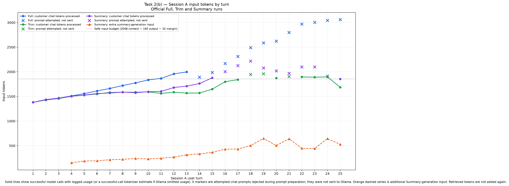

# Task 2(b) Stage 5 — Session A token analysis

## Scope and source

This report uses only the three official run IDs: `task2b_full_run3`, `task2b_trim_run2`, and `task2b_summary_run2`. The script reads `logs/calls.jsonl`, the official run manifest, the source Session A turns, and the three transcripts. Superseded and interrupted runs are excluded. No Session A replay was run during this analysis.

Every official transcript contains the exact 25 source user messages. Summary generated 22 extra `call_type=summary` calls. Tool calls have zero token fields as required. `retrieved_tokens` is reported separately and is never added to input totals.

## Token and latency comparison

| Strategy | Logged input | Logged output | Logged total | Exact Ollama input | Exact Ollama output | Chat success / fallback | Summary calls | All-call latency (ms) |
| --- | --- | --- | --- | --- | --- | --- | --- | --- |
| Full | 53,116 | 313 | 53,429 | 21,778 | 313 | 13 / 12 | 0 | 45,056 |
| Trim | 42,220 | 773 | 42,993 | 36,005 | 773 | 22 / 3 | 0 | 85,050 |
| Summary | 52,815 | 3,127 | 55,942 | 33,889 | 3,127 | 16 / 9 | 22 | 156,310 |

### Breakdown and per-turn measures

| Strategy | Chat logged input (incl. unsent) | Chat exact/estimated processed input | Unsent attempted input | Chat output | Summary input | Summary output | NLU input overhead | Embedding input overhead | Mean chat input / turn (attempted) | Median chat input / turn (attempted) | Mean input / successful chat | Median input / successful chat | Median latency (ms) |
| --- | --- | --- | --- | --- | --- | --- | --- | --- | --- | --- | --- | --- | --- |
| Full | 52,714 | 21,778 | 30,936 | 313 | 0 | 0 | 342 | 60 | 2,108.6 | 1,958 | 1,675.2 | 1,662 | 3 |
| Trim | 41,818 | 36,005 | 5,813 | 773 | 0 | 0 | 342 | 60 | 1,672.7 | 1,587 | 1,636.6 | 1,586.5 | 19.5 |
| Summary | 44,216 | 25,692 | 18,524 | 421 | 8,197 | 2,706 | 342 | 60 | 1,768.6 | 1,710 | 1,605.8 | 1,581.5 | 73.5 |

| Strategy | Mean attempted input / turn | Median attempted | Mean submitted input / turn (0 if unsent) | Median submitted | Total call latency (ms) | Median call latency (ms) |
| --- | --- | --- | --- | --- | --- | --- |
| Full | 2,108.6 | 1,958 | 871.1 | 1,381 | 45,056 | 3 |
| Trim | 1,672.7 | 1,587 | 1,440.2 | 1,581 | 85,050 | 19.5 |
| Summary | 1,768.6 | 1,710 | 1,027.7 | 1,508 | 156,310 | 73.5 |

`Logged input/output/total` sums the corresponding fields across NLU, chat, summary, tool, and embedding records. This includes logged prompt estimates for prompts rejected before Ollama. NLU and embedding input totals are shown separately as full-system accounting overhead. Embedding `extra.embedding_input_tokens` is a separate BGE-specific diagnostic and is not added to `input_tokens`.

`Exact Ollama` totals include chat and summary records whose `extra.token_counts_source` is `ollama`. Successful calls without Ollama usage would be reported in the separate local-estimate columns. No such successful fallback-counted Qwen calls occur in these runs. Prompt-preparation failures are attempted prompt counts, not model consumption.

## Plot



Solid series are successful customer-facing calls with model usage. Cross markers show attempted chat prompt counts from prompt-preparation failures; those inputs were not sent to Ollama. The orange series shows additional summary-generation input tokens by turn. Thus the plot distinguishes completed model inputs from logged-but-unsent attempts.

## Prompt failures and fallback behavior

Failed/fallback customer-facing chat records: Full 12, Trim 3, Summary 9. Prompt-preparation failures classified as unsent: Full 12, Trim 3, Summary 9. Other failed chat records after prompt preparation or with an ambiguous stage: Full 0, Trim 0, Summary 0. The unsent records have `extra.error_type=ValueError`, `api_call_ms=0`, and `prompt_build_ms=0`; their `input_tokens` preserve the attempted prompt size. The largest Full attempted prompt was 3,060 tokens. Full had successful customer-facing calls through turn 13; later oversized full-history prompts were rejected and produced deterministic fallback responses. No failed chat prompt is counted as actual model-processed input.

Prompt-preparation failure turns: Full: 14, 15, 16, 17, 18, 19, 20, 21, 22, 23, 24, 25; Trim: 18, 19, 21; Summary: 16, 17, 18, 19, 20, 21, 22, 23, 24.

Trim and Summary also reached the safe prompt limit on some turns and used the same deterministic fallback path. Their histories or summary-plus-recent contexts were not silently recategorized as another strategy. The exact failed turns and token counts are in `task2b_token_per_turn.csv` and the raw logs.

## Strategy observations

- Full has the lowest raw customer-facing input actually processed (21,778 tokens), but only 13 of 25 chat prompts were sent successfully; its lower total reflects 12 unsent prompt-budget failures, not an efficiency advantage. Mean input per successful chat is Full 1,675.2, Trim 1,636.6, and Summary 1,605.8 tokens.
- Full's logged/attempted chat inputs grow from 1,381 tokens on turn 1 and eventually exceed the 1,856-token safe input budget. It logs 52,714 attempted chat input tokens versus 41,818 for Trim. Attempts are preserved in logs, but unsent prompts do not consume model tokens.
- Trim logged 41,818 chat input tokens including its 3 unsent attempts.
- Summary adds 8,197 summary-generation input tokens and 2,706 summary-generation output tokens across 22 calls. That overhead is included once in Summary's all-call logged and exact Ollama totals.
- Summary's exact Qwen input (customer-facing plus summary calls) is 33,889 tokens versus 36,005 for Trim. Summary generation adds 8,197 input tokens while its customer-facing calls use less input; exact Qwen input-plus-output totals are 37,016 for Summary and 36,778 for Trim.
- Trim has the lowest all-call logged total (42,993) and the most successful customer-facing calls (22); in this sample it is the most favorable token/fallback trade-off. Summary retains condensed older context, but its quality or information-retention advantage was not measured, and it had 9 fallbacks.
- Logged total input-plus-output tokens are Full 53,429, Trim 42,993, Summary 55,942. These totals include NLU and embedding call fields but not `retrieved_tokens` a second time.
- The runs support a token and prompt-budget comparison only. They do not establish a response-quality or accuracy winner. No successful booking/database write occurred in these official runs.

## Reproducibility checks and limitations

The analysis validates mandatory fields, exact per-run call counts, one NLU and one chat record per user turn, Summary call configuration/purpose, zero-token tool records, duplicate complete records, transcript/source-message agreement, run IDs, and the matching database-reset fingerprints. All three reset fingerprints are `b839ab6f76c491f120b796b9189c03ac067b90b7dd027d28d05bc3be8ac2abb2`.

Actual model-processed totals are limited to Ollama-reported usage in these runs. If a future successful call lacks API usage, the script keeps its tokenizer-based estimate separate; if a request fails after dispatch without usage, actual processed tokens remain unknown rather than being inferred. The script does not estimate monetary cost or evaluate answer quality.

## Reproduction

From the project root, run:

```powershell
.\.venv\Scripts\python.exe scripts\analyze_task2b_logs.py
```

The script filters exclusively to the three official run IDs and regenerates this report, both CSVs, and the PNG without modifying `calls.jsonl`.
